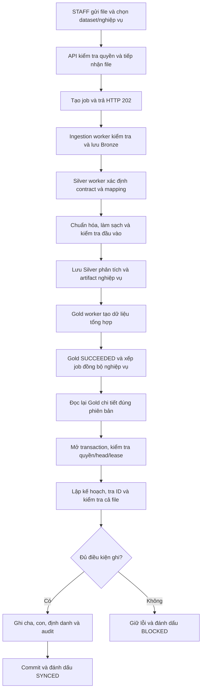

# Giải thích giải pháp upload file liên quan nhiều bảng trong UniLake BE

**Phạm vi:** mô tả phần backend đã triển khai, gồm xử lý tên cột, quan hệ giữa các bảng và các nghiệp vụ Tuyển sinh được bổ sung. Tài liệu đối chiếu với source BE ngày 18/11/2026.

**Cách đọc:** mục 1–6 giải thích cơ chế chung; mục 7–9 đi qua ví dụ; mục 10–15 giải thích cập nhật, lỗi, phân quyền và cách sử dụng. Mục 16 dẫn đến code để đối chiếu.

Các tên người, mã và ID trong ví dụ là **dữ liệu minh họa**. Chúng không khẳng định các bản ghi đó đang tồn tại trong DB của bạn.

## 1. Problem ban đầu thực chất gồm những gì?

### 1.1. Một dòng Excel có thể chứa dữ liệu của nhiều bảng

Ví dụ một dòng hồ sơ nhân sự:

| Mã NV | Họ Tên | Là giảng viên | Học vị |
| --- | --- | --- | --- |
| NV001 | Nguyễn Văn An | Có | Tiến sĩ |

Trong DB, thông tin này được chia ra:

- `employee` giữ mã nhân viên, họ tên và thông tin nhân viên.
- `lecturer` giữ thông tin giảng viên, liên kết tới nhân viên qua `employee_id`.

Vì vậy, BE cần hiểu ý nghĩa của dòng trước khi ghi: phần nào thuộc employee, phần nào thuộc lecturer và lecturer sẽ tham chiếu đúng nhân viên nào.

### 1.2. File dùng mã nghiệp vụ, DB dùng ID để liên kết

Nhân viên thường biết mã môn `CS001`, mã chương trình `CNTT` hoặc mã nhân viên `NV001`. Họ không nhất thiết biết `course_id=501` hay `employee_id=101` trong PostgreSQL.

BE phải thực hiện bước tra cứu:

```text
Mã học phần CS001
    → tìm course.course_code = CS001
    → lấy course_id = 501
    → dùng 501 cho khóa ngoại của bản ghi cần ghi
```

Đây chính là hướng xử lý bạn đã nêu. Phần triển khai mở rộng nó thành quy định dùng chung cho từng nghiệp vụ và nhiều bảng.

### 1.3. Tên cột trong file không giống tên cột DB

Các tiêu đề sau có thể cùng mang một ý nghĩa:

```text
Họ Tên
Họ Và Tên
full_name
```

Nếu người dùng đang nhập hồ sơ nhân viên, chúng có thể được ánh xạ tới trường logic `full_name`, sau đó ghi vào `employee.full_name`.

Nếu đang nhập hồ sơ thí sinh, trường đó sẽ đi tới `applicant.full_name`.

**Tên cột cần được hiểu trong ngữ cảnh nghiệp vụ.** Chỉ nhìn chữ “Họ Tên” chưa đủ để xác định bảng đích.

Trong schema hiện tại của dự án, employee, applicant và student dùng tên `full_name`. Tên `student_name` bạn từng nêu là ví dụ về sự khác biệt tên cột; BE phải dùng tên trường thực tế của schema đang triển khai.

### 1.4. Nhập lại và cập nhật có thể làm sai dữ liệu

Sau khi nhập được lần đầu, còn các vấn đề:

- Nạp lại cùng danh sách có tạo thêm nhân viên hoặc thí sinh không?
- Hai dòng cùng mã nhưng khác họ tên thì chọn dòng nào?
- Một mã môn chưa có trong danh mục thì có tự tạo môn không?
- Một file có mười dòng, dòng cuối bị lỗi thì chín dòng đầu đã được ghi chưa?
- STAFF có được sửa kết quả tuyển sinh đã chốt không?
- Hai người cùng sửa một đăng ký thì dữ liệu của ai được giữ?

Giải pháp cần xử lý cả các trường hợp này mới tạo được luồng nhập có thể vận hành.

## 2. Mình đã triển khai những phần nào?

BE đã có cơ chế nhập theo **nghiệp vụ được khai báo**, gồm bảy loại sau:

| Phòng | Mã nghiệp vụ — import_type | Bảng được ghi | Các bảng dùng để tra cứu |
| --- | --- | --- | --- |
| PNS | `hr_employee` | employee, lecturer | Hồ sơ employee hiện có |
| PNS | `hr_assignment` | assignment | employee, department, position |
| PNS | `hr_qualification` | employee_qualification | employee, qualification |
| PTS | `admissions_registration` | applicant, admission | program, admission_year, admission_method |
| PTS | `admissions_results` | admission: điểm và kết quả | Thí sinh, đăng ký, phương thức đã có |
| PTS | `admissions_enrollment` | admission: trạng thái và ngày nhập học | Đăng ký đã trúng tuyển |
| PDT | `academic_curriculum` | curriculum, curriculum_course | program, course |

Đi cùng các nghiệp vụ đó là:

- Danh mục trường đầu vào và các tên cột tương đương.
- Ánh xạ cột tường minh cho file có tên cột riêng.
- Chuẩn hóa dữ liệu theo quy định.
- Tra cứu mã sang ID và lập kế hoạch ghi nhiều bảng.
- Kiểm tra trùng, xung đột, trường bắt buộc và quan hệ trước khi ghi.
- Transaction cho cả file, kết quả theo từng bảng và lịch sử thay đổi.
- Kiểm soát phiên bản khi sửa admission.
- Quy trình đính chính có lý do cho ADMISSIONS_MANAGER/ADMIN.
- API để xem trạng thái ghi DB, lấy dữ liệu/revision hiện tại và xem lịch sử.

Nhánh cũ từng chỉ lấy dữ liệu course từ một file bảng điểm phẳng rồi báo đồng bộ đã được bỏ. File chưa có quy định đích phù hợp sẽ được yêu cầu bổ sung mapping/nghiệp vụ trước khi ghi bảng nghiệp vụ.

## 3. Những khái niệm cần phân biệt

| Khái niệm | Ý nghĩa trong luồng này |
| --- | --- |
| Domain | Lĩnh vực dữ liệu: hr, academic hoặc admissions |
| Dataset | Bộ dữ liệu dùng để tổ chức, quản lý nguồn và phạm vi truy cập |
| Mã nghiệp vụ | Mã người dùng biết, ví dụ NV001, CNTT, CS001, TS001 |
| ID của DB | Khóa do PostgreSQL quản lý, ví dụ employee_id hoặc course_id |
| PK — khóa chính | Cột hoặc nhóm cột xác định một bản ghi trong bảng |
| FK — khóa ngoại | Giá trị dùng để tham chiếu tới bản ghi của bảng khác |
| Contract nhập | Quy định BE phải làm gì với một loại file nghiệp vụ |
| Mapping | Quy tắc cột nguồn nào cung cấp giá trị cho trường logic nào |
| Profile | Cấu hình cụ thể gắn contract, mapping và cách đọc với nguồn/file |
| Namespace | Phạm vi nguồn dùng để hiểu một mã bên ngoài; hiện gắn với source_system_id |
| Job | Một lần xử lý có mã và trạng thái riêng |
| Snapshot | Một phiên bản dữ liệu được lưu để đọc lại và truy vết |
| Transaction | Nhóm thao tác DB được commit cùng nhau hoặc rollback cùng nhau |
| Upsert | Tìm bản ghi theo khóa; đã có thì cập nhật, chưa có thì tạo trong phạm vi được phép |
| Audit | Lịch sử cho biết ai đã thay đổi gì, từ đâu, trước/sau ra sao |
| Revision | Số phiên bản hiện tại của một admission, dùng để kiểm soát sửa đồng thời |

“Contract nhập” là **quy định nghiệp vụ mà BE hiểu**. File CSV mẫu chỉ là một cách biểu diễn quy định đó. Người dùng vẫn có thể dùng tiêu đề khác nếu ánh xạ được rõ ràng.

## 4. Flow tổng thể từ upload đến DB



Nếu công cụ xem Markdown không hiển thị sơ đồ, có thể đọc theo chuỗi:

```text
Upload → Bronze → Mapping/làm sạch → Silver → Gold
       → Kiểm tra nghiệp vụ và quan hệ → Transaction DB → SYNCED
```

### 4.1. API upload làm gì?

API tiếp nhận file, kiểm tra quyền/domain, đích dataset, định dạng được hỗ trợ và các điều kiện tiếp nhận. File được lưu ở vùng tiếp nhận, sau đó BE tạo job cho worker xử lý.

Phản hồi `HTTP 202` có nghĩa: **hệ thống đã nhận yêu cầu để xử lý**.

Nó chưa xác nhận dữ liệu employee, lecturer, applicant hay admission đã được ghi xong.

### 4.2. Bronze giữ gì?

Bronze giữ bằng chứng đầu vào: file gốc và thông tin nhận diện phiên bản, checksum, cách đọc, nguồn và job liên quan.

Nhờ đó, khi một điểm hoặc họ tên bị thắc mắc, có thể đối chiếu với file đã nộp, thay vì chỉ biết giá trị cuối cùng trong DB.

### 4.3. Silver xử lý gì?

Silver worker xác định nghiệp vụ, ghép cột nguồn với trường logic và chuẩn hóa dữ liệu. Ví dụ:

```text
Mã NV             → employee_code
Họ Và Tên         → full_name
Là giảng viên Có  → is_lecturer = true
Học vị Tiến sĩ    → academic_degree = Ph.D.
```

Các lỗi như tiêu đề mơ hồ, thiếu cột định danh, giá trị sai kiểu hoặc ngày không đúng định dạng có thể bị chặn ở giai đoạn này. Các kiểm tra phụ thuộc bản ghi DB sẽ tiếp tục được thực hiện trước khi ghi nghiệp vụ.

### 4.4. Vì sao có hai phần dữ liệu Silver?

Một file vừa phục vụ phân tích vừa phục vụ hồ sơ nghiệp vụ, nhưng hai mục đích không cần cùng một tập trường.

Trong các contract mới:

- **Phần phân tích** chọn các trường được khai báo phù hợp với luồng phân tích.
- **Artifact nghiệp vụ riêng** giữ các giá trị đã ánh xạ cần thiết để ghi hồ sơ, cùng vị trí dòng nguồn.

Họ tên, email, điện thoại, ngày sinh và CCCD không được đưa vào bảng phân tích của các contract mới, nhưng vẫn có thể cần trong phần nghiệp vụ để ghi đúng employee/applicant.

Vì vậy, thấy bảng phân tích không có full_name không có nghĩa BE được phép tạo employee thiếu họ tên. Bộ ghi nghiệp vụ vẫn phải kiểm tra trường bắt buộc của bảng đích.

### 4.5. Gold làm gì?

Gold có phần dữ liệu tổng hợp phục vụ báo cáo. Các file nghiệp vụ chi tiết cũng được đưa sang vùng Gold phục vụ đồng bộ, đọc lại đúng version/checksum rồi mới dùng để ghi DB.

Luồng hiện tại có hai mốc riêng:

| Mốc | Xác nhận điều gì? |
| --- | --- |
| Gold `SUCCEEDED` | Bản Gold đã công bố thành công |
| Đồng bộ DB `SYNCED` | Transaction ghi các bảng nghiệp vụ đã hoàn tất |

Ví dụ, Gold có thể đã đếm được 100 dòng của file, nhưng bước đồng bộ DB bị BLOCKED do một mã học phần chưa tồn tại.

### 4.6. “Đã ghi DB” cần nói rõ là bảng nào

Ngay từ lúc upload, PostgreSQL đã có thể chứa **metadata điều phối**, như ingestion_job hoặc dataset được tạo/dùng lại.

Khi công bố Gold, DB còn có dữ liệu tổng hợp như `gold.aggregate` và view báo cáo hiện hành.

Nhưng các **bảng nghiệp vụ** như employee, lecturer, curriculum hoặc admission chỉ được ghi sau bước kiểm tra và transaction đồng bộ.

Do đó, câu trả lời chính xác là:

> Muốn biết hồ sơ nghiệp vụ đã được ghi hay chưa, hãy xem database_status/database_committed của lượt nhập. Sự tồn tại của job hoặc bản Gold chưa đủ để kết luận.

## 5. Tên cột khác nhau được xử lý như thế nào?

### 5.1. Bước đầu là chọn đúng ngữ cảnh

BE cần biết file thuộc nghiệp vụ nào trước khi quyết định ý nghĩa của cột.

Ví dụ:

| Ngữ cảnh | Tiêu đề nguồn | Trường logic | Đích nghiệp vụ |
| --- | --- | --- | --- |
| Hồ sơ nhân viên | Họ Tên | full_name | employee.full_name |
| Hồ sơ đăng ký tuyển sinh | Họ Tên | full_name | applicant.full_name |
| Khung chương trình | Mã học phần | course_code | Dùng tra course_id cho curriculum_course |

Một cột tên “Mã” quá chung chung không đủ để tự xác định là mã nhân viên, chương trình hay học phần.

### 5.2. Tên tương đương đã khai báo được nhận diện

BE có danh mục tên tương đương theo trường. Việc so khớp có chuẩn hóa cách viết như chữ hoa/thường, khoảng trắng và dấu phân tách.

Các tên “Họ Tên”, “Họ Và Tên” và full_name đã được khai báo cho trường họ tên. Đây là nhận diện từ quy định được quản lý; BE không tự dịch mọi tên cột bất kỳ sang một cột DB.

Tên không dấu hoặc viết tắt riêng của một đơn vị vẫn cần mapping nếu chưa có trong danh mục.

### 5.3. Với tên riêng của phòng ban, gửi mapping tường minh

Giả sử file có các cột:

```text
Mã nội bộ | Tên cán bộ | Là giảng viên | Trạng thái nhân viên | Ghi chú
```

Cấu hình gửi cùng file có thể là:

```json
{
  "import_type": "hr_employee",
  "version": "1",
  "field_mapping": {
    "employee_code": "Mã nội bộ",
    "full_name": "Tên cán bộ"
  },
  "ignored_columns": ["Ghi chú"]
}
```

Hai cột còn lại được ghép theo tên tương đương đã biết. Ghi chú được xác nhận không tham gia ghi DB; nội dung gốc vẫn nằm trong Bronze.

Mapping này gắn với lượt nhập/profile. Với một lượt upload mới có tên cột riêng, client cần gửi cấu hình tương ứng hoặc nguồn cần có profile tương thích. BE không tự biến mọi lựa chọn riêng thành tên tương đương chung cho toàn hệ thống.

### 5.4. Khi file có cả “Họ Tên” và “Họ Và Tên”

BE hiện báo `IMPORT_MAPPING_AMBIGUOUS` vì có nhiều cột có thể cung cấp cùng một trường.

Người cấu hình phải chọn rõ một cột làm nguồn và xác nhận cách xử lý cột còn lại. Hiện tại, lựa chọn thông thường là mapping một cột và khai báo bỏ qua cột còn lại.

Các contract phiên bản này chưa tự ghép Họ + Tên, tự coalesce hai cột hoặc tự chọn cột có vẻ đúng hơn. Những phép biến đổi đó cần quy tắc riêng trước khi bật.

### 5.5. Cách xử lý giá trị cũng phải rõ

| Dữ liệu | Cách xử lý hiện tại |
| --- | --- |
| Mã 00123 | Nhận dạng chuỗi để giữ số 0 đầu |
| Mã đã bị Excel đổi thành số và mất số 0 | Không tự đoán lại mã ban đầu |
| Có/Không ở cột boolean đã khai báo | Chuyển sang true/false |
| Ngày dạng chuỗi | Theo date_format đã chọn; mặc định ISO YYYY-MM-DD |
| 01/02/2026 | Cần khai báo định dạng tương ứng, ví dụ %d/%m/%Y |
| Điểm thập phân | Theo cách biểu diễn số được hỗ trợ, ví dụ 25.50; không tự đoán dấu phân cách |
| Trạng thái hoặc học vị | Theo từ điển giá trị của trường |
| Giá trị ngoài danh mục | Báo lỗi để bổ sung quy định hoặc sửa dữ liệu |

Tên và ý nghĩa tiếng Việt trong các bảng giải thích của tài liệu không có nghĩa mọi cách viết tiếng Việt đều được chấp nhận làm giá trị đầu vào. Danh mục thực tế được trả từ API import-types.

## 6. BE xử lý một file thành nhiều thao tác DB như thế nào?

Phần này là bước “tiền xử lý trước khi ghi DB” mà bạn đề cập.

### 6.1. Chuẩn hóa thành trường nghiệp vụ

BE đổi dữ liệu từ tên cột nguồn sang các trường logic đã khai báo. Sau bước này, bộ xử lý không còn phải hỏi “cột Họ Tên hay Tên cán bộ ở đâu” cho từng câu lệnh SQL nữa.

### 6.2. Xác định đối tượng và khóa

Tùy contract, một dòng có thể sinh ra một hoặc nhiều đối tượng:

```text
Dòng hồ sơ nhân viên
    → employee theo employee_code
    → lecturer khi is_lecturer=true

Dòng đăng ký tuyển sinh
    → applicant theo namespace + applicant_code
    → admission theo tổ hợp bốn khóa tham chiếu

Dòng khung chương trình
    → curriculum theo program_id + version
    → curriculum_course theo curriculum_id + course_id
```

Khóa được chọn theo ý nghĩa nghiệp vụ và ràng buộc DB. Họ tên không được dùng làm khóa để ghép hai người thành một.

### 6.3. Gom các đối tượng xuất hiện nhiều lần

Hai dòng đăng ký của TS001 cho hai chương trình phải dùng chung một applicant.

Tương tự, mười dòng học phần cùng chương trình và phiên bản phải dùng chung một curriculum.

Bộ lập kế hoạch gom các đối tượng theo khóa. Các giá trị không trống phải nhất quán. Nếu cùng khóa có dữ liệu mâu thuẫn, file bị chặn thay vì chọn ngẫu nhiên một dòng.

### 6.4. Tra cứu bảng chỉ đọc

Ví dụ một dòng curriculum có program_code=CNTT và course_code=CS001. BE tra DB để lấy program_id và course_id.

Trong contract này, program và course là bảng **lookup-only**: được dùng để tìm ID, không được tạo/cập nhật từ file curriculum.

Nếu một mã không có hoặc kết quả tra cứu mơ hồ, BE lưu lỗi. Quy định bạn đã chốt là bổ sung danh mục rồi nhập lại.

### 6.5. Kiểm tra cả kế hoạch trước khi ghi

BE kiểm tra các điều kiện như:

- Đủ trường bắt buộc cho bản ghi sẽ tạo.
- Đúng kiểu, độ dài, khoảng giá trị và quan hệ.
- Không xung đột unique hoặc dữ liệu giữa nhiều dòng.
- Không ghi đè bản ghi do nguồn khác đang quản lý.
- Đúng quy tắc trạng thái/revision đối với admission.

Một số lỗi đã được phát hiện ở Silver. Những kiểm tra cần dữ liệu hiện tại của PostgreSQL được làm trong bước lập kế hoạch nghiệp vụ.

### 6.6. Ghi theo thứ tự phụ thuộc

Khi cần tạo cả cha và con:

```text
Tạo cha → nhận ID từ DB → gắn ID đó cho FK của con → ghi con
```

Ví dụ employee được tạo trước để có employee_id; lecturer sau đó dùng đúng employee_id đó.

### 6.7. Vị trí của transaction trong code

Thứ tự quan trọng là **kiểm tra trước các câu lệnh ghi nghiệp vụ**. Các bước đọc, khóa tham chiếu và lập kế hoạch phụ thuộc DB nằm trong transaction đồng bộ; chúng không phải toàn bộ đều chạy ngoài transaction.

```text
Đọc/kiểm chứng artifact Gold
    → mở transaction
    → kiểm tra Gold head, lease và quyền hiện hành khi nghiệp vụ yêu cầu
    → khóa/đọc dữ liệu cần đối soát
    → lập và kiểm tra toàn bộ kế hoạch
    → ghi các bảng nghiệp vụ
    → ghi định danh và audit
    → cập nhật kết quả đồng bộ
    → commit
```

Lỗi nghiệp vụ hoặc lỗi DB làm rollback các thay đổi nghiệp vụ của file. Metadata của job và lỗi vẫn được lưu để người dùng biết chuyện gì đã xảy ra.

## 7. Ví dụ A — Một dòng tạo nhân viên và giảng viên

### 7.1. File đầu vào

Nghiệp vụ: `hr_employee`.

```csv
Mã NV,Họ Và Tên,Là giảng viên,Trạng thái nhân viên,Học vị
NV001,Nguyễn Văn An,Có,ACTIVE,Tiến sĩ
NV002,Trần Thị Bình,Không,ACTIVE,
```

### 7.2. BE hiểu dữ liệu thế nào?

| Dòng | Đối tượng employee | Đối tượng lecturer |
| --- | --- | --- |
| NV001 | Mã NV001, tên Nguyễn Văn An, trạng thái ACTIVE | Có; học vị chuẩn hóa Ph.D. |
| NV002 | Mã NV002, tên Trần Thị Bình, trạng thái ACTIVE | Không tạo từ dòng này |

Giả sử hai nhân viên chưa có, PostgreSQL sinh ID 101 và 102.

**Bảng employee sau khi ghi:**

| employee_id | employee_code | full_name | employee_status |
| --- | --- | --- | --- |
| 101 | NV001 | Nguyễn Văn An | ACTIVE |
| 102 | NV002 | Trần Thị Bình | ACTIVE |

**Bảng lecturer sau khi ghi:**

| employee_id | academic_degree |
| --- | --- |
| 101 | Ph.D. |

lecturer.employee_id vừa xác định hồ sơ giảng viên vừa liên kết về employee. File không cần đưa ID 101 vào; BE lấy ID thực tế sau khi tìm hoặc tạo employee.

### 7.3. Nếu nạp lại thì sao?

BE tìm employee bằng employee_code. Với cùng dữ liệu, kết quả vẫn là hai employee và một lecturer, không tăng thành bốn employee.

Nếu tên NV001 đổi hợp lệ trong file, BE cập nhật bản ghi đã có. Ô trống trong trường cập nhật giữ giá trị cũ; tạo mới vẫn phải có đủ trường bắt buộc.

### 7.4. Nếu “Có” đổi thành “Không”?

Quy tắc bạn đã chốt là giữ hồ sơ lecturer hiện có và các liên kết của nó.

Ở lần nhập đó, cờ Không làm BE không tạo/cập nhật lecturer từ dòng tương ứng. Nó chưa phải một nghiệp vụ chấm dứt giảng dạy hoặc xóa hồ sơ giảng viên.

Dòng khai Không nhưng vẫn điền học vị/học hàm/lĩnh vực nghiên cứu sẽ bị báo mâu thuẫn. Cần sửa file để khai báo nhất quán.

## 8. Ví dụ B — Một khung chương trình có nhiều học phần

### 8.1. Danh mục đã có trong DB

| Bảng | ID giả định | Mã |
| --- | --- | --- |
| program | program_id=11 | CNTT |
| course | course_id=501 | CS001 |
| course | course_id=502 | CS002 |

### 8.2. File đầu vào

Nghiệp vụ: `academic_curriculum`.

```csv
Mã chương trình,Phiên bản,Mã khung,Tên khung,Mã học phần,Học kỳ,Bắt buộc
CNTT,2026,K26,Khung CNTT 2026,CS001,1,Có
CNTT,2026,K26,Khung CNTT 2026,CS002,2,Có
```

### 8.3. Kế hoạch của BE

```text
Tra CNTT → program_id=11
Tra CS001 → course_id=501
Tra CS002 → course_id=502

Gom một curriculum theo (program_id=11, version=2026)
Tạo hai liên kết curriculum_course cho hai course
```

Giả sử DB tạo curriculum_id=900.

**curriculum:**

| curriculum_id | program_id | curriculum_code | version |
| --- | --- | --- | --- |
| 900 | 11 | K26 | 2026 |

**curriculum_course:**

| curriculum_id | course_id | semester_no | is_required |
| --- | --- | --- | --- |
| 900 | 501 | 1 | true |
| 900 | 502 | 2 | true |

Đây là quan hệ nhiều–nhiều: một curriculum có nhiều course; một course có thể thuộc nhiều curriculum. Bảng curriculum_course giữ từng liên kết và các thuộc tính của liên kết đó.

Nạp lại cùng file vẫn có một khung và hai liên kết. Contract này không sửa program/course.

### 8.4. Nếu CS002 chưa có thì sao?

BE báo thiếu course_code=CS002 ở dòng/cột tương ứng. Cả file bị chặn; không tạo riêng curriculum và liên kết CS001 rồi để thiếu CS002.

Sau khi danh mục course được bổ sung bằng luồng có quyền, người dùng nhập lại file hoặc quản trị retry bước đồng bộ còn hợp lệ.

Mã học phần tiên quyết, nếu có trong file, cũng được tra trong course để lấy prerequisite_course_id.

## 9. Ví dụ C — Một thí sinh, hai đăng ký, sau đó xét tuyển và nhập học

Đây là một chuỗi liên tục để thấy lý do phải tách các nghiệp vụ.

### 9.1. Các danh mục đã có

| Danh mục | Mã | ID giả định |
| --- | --- | --- |
| program | CNTT | 11 |
| program | QTKD | 12 |
| admission_year | 2026 | 21 |
| admission_method | THPT, max_score=30 | 31 |

Giả sử nguồn hồ sơ dùng namespace 17.

### 9.2. Bước 1: Nộp hồ sơ đăng ký

Nghiệp vụ: `admissions_registration`.

```csv
Mã thí sinh,Họ Tên,Mã chương trình,Năm tuyển sinh,Mã phương thức,Nguyện vọng,Trạng thái đăng ký
TS001,Nguyễn Minh An,CNTT,2026,THPT,1,APPLIED
TS001,Nguyễn Minh An,QTKD,2026,THPT,2,APPLIED
```

BE tạo một applicant và hai admission. Giả sử applicant_id được sinh là 401.

**applicant:**

| applicant_id | full_name |
| --- | --- |
| 401 | Nguyễn Minh An |

**admission:**

| admission_id | applicant_id | program_id | year_id | method_id | preference_rank | admission_status | enrollment_status | revision |
| --- | --- | --- | --- | --- | --- | --- | --- | --- |
| 7001 | 401 | 11 | 21 | 31 | 1 | APPLIED | NULL | 1 |
| 7002 | 401 | 12 | 21 | 31 | 2 | APPLIED | NULL | 1 |

Trong bảng minh họa, year_id và method_id viết ngắn cho admission_year_id và admission_method_id.

Khóa chống trùng đăng ký là:

```text
(applicant_id, program_id, admission_year_id, admission_method_id)
```

Hai dòng khác chương trình tạo hai đăng ký hợp lệ, nhưng không tạo hai người.

### 9.3. TS001 nằm ở đâu nếu applicant không có cột applicant_code?

Mã nguồn được lưu trong bảng định danh `app.gold_record_identity`. Ví dụ biểu diễn rút gọn:

| namespace | entity | source_key | target_key |
| --- | --- | --- | --- |
| 17 | applicant | ["TS001"] | {"applicant_id":401} |

source_key được mã hóa theo quy định nội bộ. Ý nghĩa của hàng này là: mã TS001 của nguồn 17 đang chỉ tới applicant 401.

Nhờ đó file kết quả sau này không cần biết DB đã sinh ID 401.

### 9.4. Bước 2: Nộp kết quả xét tuyển

Nghiệp vụ phải chọn tường minh: `admissions_results`.

```csv
applicant_code,program_code,year_label,method_code,expected_revision,admission_score,admission_status
TS001,CNTT,2026,THPT,1,25.50,ACCEPTED
```

BE thực hiện:

1. Tìm TS001 trong namespace 17 → applicant_id=401.
2. Tìm đăng ký khớp applicant 401, CNTT, năm 2026, phương thức THPT → admission 7001.
3. Kiểm tra revision hiện tại là 1.
4. Kiểm tra 25.50 đúng kiểu, đúng độ chính xác và nằm trong thang [0,30].
5. Kiểm tra APPLIED → ACCEPTED là chuyển trạng thái được phép.
6. Cập nhật 7001 và ghi audit.

**Kết quả của admission 7001:**

| Trường | Trước | Sau |
| --- | --- | --- |
| admission_score | NULL | 25.50 |
| admission_status | APPLIED | ACCEPTED |
| enrollment_status | NULL | PENDING |
| revision | 1 | 2 |

Admission 7002 vẫn giữ APPLIED. Applicant, program, năm tuyển sinh và phương thức không được tạo từ file kết quả này.

**ACCEPTED nghĩa là trúng tuyển; PENDING nghĩa là đang chờ quyết định nhập học.** Hai thông tin diễn tả hai việc khác nhau.

### 9.5. Bước 3: Xác nhận nhập học

Nghiệp vụ phải chọn tường minh: `admissions_enrollment`.

```csv
applicant_code,program_code,year_label,method_code,expected_revision,enrollment_status,enrollment_date
TS001,CNTT,2026,THPT,2,CONFIRMED,2026-11-18
```

BE kiểm tra đăng ký đã ACCEPTED, revision=2, chuyển PENDING → CONFIRMED hợp lệ và có ngày xác nhận từ file.

| Trường | Trước | Sau |
| --- | --- | --- |
| enrollment_status | PENDING | CONFIRMED |
| enrollment_date | NULL | 2026-11-18 |
| revision | 2 | 3 |

Ngày xác nhận được lấy từ hồ sơ/file. Thời điểm upload và ngày xác nhận nhập học là hai thông tin riêng.

Luồng này chưa tạo student hoặc cấp mã sinh viên. Đó là nghiệp vụ tiếp theo cần quy định riêng.

### 9.6. Những chuyển trạng thái STAFF được phép làm

| Trạng thái xét tuyển hiện tại | Thao tác STAFF |
| --- | --- |
| APPLIED | Sang WAITLISTED, ACCEPTED hoặc REJECTED |
| WAITLISTED | Sang ACCEPTED hoặc REJECTED |
| ACCEPTED/REJECTED | Giữ nguyên; thay đổi kết quả đã chốt cần đính chính |

| Trạng thái nhập học hiện tại | Thao tác STAFF |
| --- | --- |
| PENDING | Sang CONFIRMED hoặc DECLINED |
| CONFIRMED/DECLINED | Giữ nguyên; thay đổi đã chốt đi qua Manager/Admin |
| WITHDRAWN | Không tự khôi phục qua file STAFF |
| NULL của dữ liệu cũ | Cần đối soát riêng |

Với phương thức có dùng điểm, ACCEPTED/REJECTED phải có điểm. Phương thức max_score=0 phải để trống điểm, kể cả giá trị 0 cũng không dùng thay cho “không có điểm”.

### 9.7. Bước 4: Manager đính chính điểm đã chốt

Giả sử admission 7001 đang CONFIRMED, điểm 25.50, revision=3. Biên bản đối chiếu xác nhận điểm đúng là 26.50.

Manager/Admin tạo yêu cầu:

```http
POST /api/v1/admissions/corrections
```

```json
{
  "dataset_id": 31,
  "admission_id": 7001,
  "expected_revision": 3,
  "operation": "RESULT_CORRECTION",
  "reason": "Điều chỉnh điểm theo biên bản đối chiếu của phòng tuyển sinh",
  "changes": {"admission_score": "26.50"}
}
```

BE trả yêu cầu REQUESTED cùng preview trước/sau. **Tại bước tạo yêu cầu, điểm trong admission vẫn là 25.50.**

Sau khi xem trước, người đủ quyền áp dụng:

```http
POST /api/v1/admissions/corrections/{correction_id}/apply
```

BE đọc lại quyền và revision. Hợp lệ thì ghi điểm 26.50, tăng revision lên 4, ghi người áp dụng, lý do và dữ liệu trước/sau.

Gọi apply lại cùng yêu cầu APPLIED trả biên nhận đã có, không ghi điểm thêm lần nữa. Theo quy tắc đã duyệt, một Manager đủ quyền có thể tạo và áp dụng; không có yêu cầu hai người phê duyệt khác nhau.

### 9.8. Rút, khôi phục và dữ liệu cũ

| Tình huống | Operation của Manager/Admin | Kết quả chính |
| --- | --- | --- |
| Hồ sơ đang CONFIRMED cần rút | ENROLLMENT_CORRECTION → WITHDRAWN | Giữ ngày xác nhận cũ và lưu lý do |
| Hồ sơ WITHDRAWN cần khôi phục | RESTORE_ENROLLMENT | Về PENDING hoặc CONFIRMED; CONFIRMED cần ngày tường minh |
| Hồ sơ cũ ACCEPTED nhưng enrollment_status=NULL | RECONCILE_LEGACY | Xác định quyết định thực tế sau đối soát |

Migration giữ NULL cho dữ liệu cũ chưa có quyết định nhập học. BE không tự diễn giải NULL thành PENDING hoặc CONFIRMED.

Nếu hồ sơ cũ chưa có ánh xạ mã nguồn, cần bảng đối chiếu có bằng chứng trước. Luồng đối soát trạng thái không tự ghép thí sinh theo tên.

## 10. Nhập lại, ô trống và sửa đồng thời được xử lý ra sao?

### 10.1. Nhập lại không đồng nghĩa tạo thêm

BE tìm theo khóa nghiệp vụ trước khi tạo. Với cùng dữ liệu, kết quả được tính là unchanged.

Đối với admission, lượt cập nhật còn phải đáp ứng điều kiện revision hoặc bằng chứng replay ở mục 10.3–10.4. Chỉ trùng dữ liệu không cho phép bỏ qua kiểm soát phiên bản.

Ví dụ:

| File | Lần đầu | Nạp lại cùng dữ liệu |
| --- | --- | --- |
| NV001 kèm giảng viên | Một employee + một lecturer | Vẫn một employee + một lecturer |
| TS001 đăng ký CNTT và QTKD | Một applicant + hai admission | Vẫn một applicant + hai admission |
| Khung K26 có CS001/CS002 | Một curriculum + hai liên kết | Vẫn một curriculum + hai liên kết |

Việc vắng một hồ sơ trong file mới không tự trở thành lệnh xóa hồ sơ đó khỏi DB.

### 10.2. Ô trống khi cập nhật

Ví dụ DB đang có phone=0012345678, file mới bỏ trống điện thoại. Quy tắc đã chốt là giữ giá trị cũ.

Đối với tạo mới, BE vẫn yêu cầu những trường schema bắt buộc. “Ô trống giữ giá trị cũ” không tạo ra giá trị cũ cho một hồ sơ chưa tồn tại.

Một ô trống cũng không thay thế điều kiện bắt buộc để thực hiện nghiệp vụ. Ví dụ xác nhận CONFIRMED vẫn cần ngày xác nhận hợp lệ.

### 10.3. expected_revision có ý nghĩa gì?

Nó thể hiện lời xác nhận của người gửi:

> Tôi đang sửa dựa trên phiên bản X của đăng ký này.

Ví dụ hai người đều đang cầm revision=2:

| Bước | Người A | Người B |
| --- | --- | --- |
| Chuẩn bị | Sửa dựa trên revision 2 | Sửa dựa trên revision 2 |
| A ghi trước | Thành công, DB sang revision 3 | Chưa ghi |
| B gửi thay đổi khác | — | Phiên bản 2 đã cũ, BE báo xung đột |

Điều kiện ghi tương đương:

```sql
UPDATE app.admission
SET ...
WHERE admission_id = :id
  AND revision = :expected_revision;
```

Ví dụ SQL chỉ minh họa nguyên tắc. Code thực tế còn khóa bản ghi, kiểm tra chính sách và sử dụng trigger để quản lý revision/audit.

Revision thuộc cả bản ghi admission. Một cột khác được cập nhật cũng có thể làm file đang cầm trở thành phiên bản cũ.

### 10.4. Vì sao nạp lại đúng file đã ghi vẫn có thể thành công?

BE có kiểm tra replay bằng bằng chứng file/cấu hình, thao tác và audit. Nộp lại đúng nội dung đã áp dụng được giữ nguyên khi kết quả đã ghi đó vẫn là revision hiện tại.

Đây không phải quyền dùng mọi revision cũ. Nếu sau đó Manager đã đính chính sang phiên bản mới, file cũ không được dùng làm căn cứ ghi đè.

Ví dụ file nhập học ở mục 9 ghi revision 2 → 3. Nạp lại đúng file có thể giữ nguyên. Sau khi Manager sửa điểm làm bản ghi sang revision 4, file nhập học cũ dựa trên revision 2 sẽ cần được đối chiếu lại.

### 10.5. Bằng cấp và phân công có các giới hạn riêng

- Phân công cần assignment_code ổn định trong nguồn để biết đang sửa phân công nào.
- department trong luồng này chỉ tra PDT/PNS/PTS đang ACTIVE; mã khoa/bộ môn cần danh mục tổ chức riêng.
- Bằng cấp nhân viên dùng cặp employee_id + qualification_id. Qualification được tra theo tên và loại nếu có; kết quả mơ hồ bị chặn.
- Schema hiện chưa biểu diễn nhiều lần cấp chứng chỉ cho cùng một cặp nhân viên–bằng cấp. Thay cơ sở/năm cấp của cặp đã có bị chặn để tránh ghi đè một chứng chỉ khác.

## 11. Khi lỗi xảy ra, dữ liệu nào được giữ?

### 11.1. Lỗi mapping hoặc kiểu dữ liệu

Ví dụ thiếu expected_revision trong file kết quả hoặc có hai cột họ tên cùng khớp.

File đã nhận có thể vẫn tồn tại ở vùng tiếp nhận/Bronze và job có báo cáo lỗi. Lượt xử lý chưa đủ điều kiện đi tới ghi nghiệp vụ.

### 11.2. Thiếu mã tham chiếu

Ví dụ curriculum có CS999 nhưng course chưa có mã này.

BE chặn đồng bộ, báo trường/mã cần đối soát. Contract curriculum không tự tạo course để điền FK.

### 11.3. Mâu thuẫn giữa nhiều dòng

Ví dụ cùng mã NV001 nhưng hai dòng đưa ra họ tên khác nhau, hoặc cùng một khung/phiên bản nhưng khai báo thông tin khung khác nhau.

Các lớp kiểm tra làm sạch/lập kế hoạch chặn dữ liệu xung đột. Người nạp cần sửa về một thông tin nhất quán; BE không tự chọn dòng cuối.

### 11.4. Lỗi ở bảng con sau khi đã chạy lệnh ghi bảng cha

Giả sử DB từ chối insert lecturer vì một ràng buộc DB. Transaction làm rollback employee vừa được tạo trong cùng lượt nhập, cùng các thay đổi định danh/audit thuộc transaction đó.

Những hồ sơ đã tồn tại từ trước không bị xóa. Job vẫn giữ trạng thái lỗi để điều tra.

### 11.5. Báo lỗi có đến dòng/cột không?

Các lỗi mapping/dữ liệu/quan hệ được BE chủ động kiểm tra có thông tin field, column và locator nguồn khi áp dụng được. Xung đột nhiều dòng có thêm vị trí dòng trước để đối chiếu.

Ví dụ diễn giải cho người nạp:

| Vị trí minh họa | Cột | Lỗi | Cách xử lý |
| --- | --- | --- | --- |
| Header | Họ Tên và Họ Và Tên | Mapping mơ hồ | Chọn rõ cột nguồn |
| Sheet1, dòng 3 | Mã học phần | Không tìm thấy course | Kiểm tra mã/bổ sung danh mục |
| Dòng 2 | Điểm xét tuyển | 31 vượt thang 30 | Đối chiếu và sửa điểm |
| Dòng 2 | Phiên bản hiện tại | Revision đã cũ | Lấy dữ liệu hiện tại để đối soát |

Định dạng chuỗi locator cụ thể do reader cung cấp. Lỗi hạ tầng hoặc ràng buộc DB ngoài những kiểm tra đã khai báo có thể chỉ trả mã lỗi tổng quát; không phải mọi lỗi DB đều có sẵn dòng/cột chi tiết.

### 11.6. Sửa xong có tự chạy lại không?

Nếu file sai, nộp lại file đã sửa. Nếu chỉ thiếu danh mục, bổ sung danh mục rồi nộp lại hoặc quản trị retry bước đồng bộ hợp lệ.

Endpoint retry đồng bộ Gold hiện có dành cho quản trị dữ liệu và chỉ áp dụng khi job/bản Gold còn phù hợp. Không giả định mọi lỗi thiếu danh mục đều tự chạy lại ngay khi một bảng master thay đổi.

## 12. Phân quyền và phạm vi nguồn

| Vai trò | Phạm vi chính liên quan giải pháp |
| --- | --- |
| HR_STAFF | Nộp file thuộc hr |
| ACADEMIC_STAFF | Nộp file thuộc academic |
| ADMISSIONS_STAFF | Nộp file thuộc admissions, cập nhật theo quy tắc STAFF |
| ADMISSIONS_MANAGER | Xem dữ liệu trong phạm vi PTS và thực hiện yêu cầu đính chính được phép |
| ADMIN | Quyền quản trị tương ứng, gồm đính chính Tuyển sinh |
| DATA_ADMIN | Có quyền nộp file/quản trị dữ liệu hiện có; vai trò này đơn lẻ không được đính chính kết quả đã chốt |

Đối với các luồng Tuyển sinh, BE đọc lại quyền và tình trạng hoạt động của tài khoản ngay trước khi ghi. File xếp hàng lúc còn quyền không bảo đảm sẽ được ghi nếu quyền đó đã bị thu hồi.

### 12.1. Namespace giải quyết điều gì?

Mã TS001 ở nguồn A có thể khác TS001 ở nguồn B. Namespace giúp BE biết mã đang được hiểu trong phạm vi nào.

```text
Nguồn 17 + mã TS001 → applicant 401
Nguồn 18 + mã TS001 → chưa chắc là applicant 401
```

BE không tự hợp nhất hai người chỉ vì tên hoặc mã trông giống nhau. Khi có xung đột giữa nguồn đang quản lý và nguồn muốn ghi đè, dữ liệu cần đối soát.

### 12.2. Dataset, tên file và namespace không phải cùng một thứ

Trong triển khai hiện tại, namespace lấy từ source_system_id. Đổi tên file hoặc đổi dataset không tự động có nghĩa đã đổi namespace; cần xem source_system_id thực tế.

Dataset còn dùng để kiểm tra quyền và lấy phạm vi nguồn. API registrations tra hồ sơ theo namespace/khóa nghiệp vụ được phép, không chỉ theo các dòng từng xuất hiện trong một tên file.

Một dataset có thể chứa các file đăng ký, kết quả và nhập học khác nhau. Chúng phải cùng nguồn định danh phù hợp để các mã thí sinh trỏ tới đúng hồ sơ.

## 13. BE đã thêm hoặc thay đổi gì trong DB và source?

### 13.1. DB

| Thành phần | Ý nghĩa |
| --- | --- |
| admission.enrollment_status | Quyết định nhập học, tách khỏi kết quả xét tuyển |
| admission.enrollment_date | Ngày xác nhận do hồ sơ cung cấp |
| admission.revision | Phiên bản hiện tại của admission |
| app.gold_record_identity | Liên kết mã nguồn/khóa nguồn với bản ghi DB |
| app.business_import_change | Kết quả thêm/sửa/giữ nguyên và bằng chứng theo từng lượt nhập nghiệp vụ |
| app.admission_event | Audit thay đổi admission với phiên bản trước/sau và ngữ cảnh thao tác |
| app.admission_correction | Yêu cầu đính chính, lý do, người tạo/áp dụng, preview và kết quả |
| Trigger admission | Quản lý tăng revision khi dữ liệu thực sự đổi và ghi audit |

Bảng gold_record_identity đã có trong nền đồng bộ và được tái sử dụng. Các bảng audit/correction và trường nhập học được bổ sung theo migration của đợt triển khai.

Lệnh SQL quản trị trực tiếp vẫn làm tăng revision khi dữ liệu đổi. Nếu không có ngữ cảnh ứng dụng, audit ghi UNATTRIBUTED; BE không tạo người thao tác giả cho lệnh đó.

### 13.2. Những phần xử lý chính

| Phần | Vai trò |
| --- | --- |
| Danh mục import contract | Khai báo trường, tên tương đương, nghiệp vụ và bảng được ghi |
| Business import profile | Gắn quy định vào file thật, giữ mapping/fingerprint và chuẩn bị artifact nghiệp vụ |
| Planner | Gom đối tượng, tra tham chiếu, kiểm tra kế hoạch và thứ tự ghi |
| Business identity | Dùng chung danh mục bảng và cơ chế định danh |
| Gold business sync | Đọc Gold chi tiết, kiểm tra quyền ghi hiện hành/head/lease và quản lý transaction |
| Admissions policy | Quy tắc điểm, trạng thái, đính chính, khôi phục và dữ liệu cũ |
| Admissions API | Đọc hồ sơ/revision, export CSV, tạo/áp dụng yêu cầu và đọc lịch sử |

Các import giữa module được đưa qua hợp đồng công khai; phần định danh được tách dùng chung để tránh vòng phụ thuộc. Fixture có checksum được chuẩn hóa LF để kết quả kiểm thử ổn định trên Windows.

## 14. Cách xem và thử luồng trên BE

### 14.1. Các API cần biết

| Mục đích | API |
| --- | --- |
| Xem nghiệp vụ và trường được hỗ trợ | GET /api/v1/ingestion/import-types |
| Kiểm tra cách ghép header | POST /api/v1/ingestion/imports/analyze |
| Nộp file | POST /api/v1/ingestion/uploads |
| Xem kết quả ghi nghiệp vụ | GET /api/v1/ingestion/jobs/{job_id}/business-import |
| Lấy hồ sơ/revision hiện tại | GET /api/v1/admissions/registrations |
| Tải CSV có expected_revision | GET /api/v1/admissions/registrations/export |
| Tạo yêu cầu đính chính | POST /api/v1/admissions/corrections |
| Xem yêu cầu | GET /api/v1/admissions/corrections/{correction_id} |
| Áp dụng yêu cầu | POST /api/v1/admissions/corrections/{correction_id}/apply |
| Xem audit | GET /api/v1/admissions/registrations/{admission_id}/history |

API analyze chỉ kiểm tra ánh xạ header, không thay thế kiểm tra các dòng và quan hệ DB ở các bước sau.

### 14.2. Cách gửi nghiệp vụ cùng file

API upload nhận multipart, gồm các trường hiện có như dataset_id/file và trường bổ sung import_options dưới dạng chuỗi JSON.

Ví dụ nội dung import_options:

```json
{"import_type":"admissions_results","version":"1"}
```

Với các nghiệp vụ nhận diện được duy nhất và đủ cột đã biết, BE có thể tiếp tục tự động theo cấu hình. Riêng file kết quả/nhập học cần chọn import_type tường minh để xác định đúng hành động.

Không cần thêm bước Manager duyệt thủ công cho mọi file hợp lệ. Yêu cầu đính chính là quy trình riêng dành cho những thay đổi đã chốt hoặc tình huống đặc biệt được quy định.

### 14.3. Đọc báo cáo đồng bộ

Ví dụ JSON rút gọn của một file chứa một nhân viên kèm giảng viên:

```json
{
  "bronze_status": "SUCCESS",
  "silver_status": "SUCCESS",
  "gold_status": "SUCCEEDED",
  "database_status": "SYNCED",
  "database_committed": true,
  "database_result": {
    "entities": {"employee": 1, "lecturer": 1},
    "tables": {
      "employee": {"inserted": 1, "updated": 0, "unchanged": 0},
      "lecturer": {"inserted": 1, "updated": 0, "unchanged": 0}
    },
    "input_rows": 1,
    "atomic": true
  }
}
```

Một dòng file có thể sinh hai bản ghi nghiệp vụ, nên input_rows và tổng số đối tượng được đồng bộ không nhất thiết bằng nhau.

### 14.4. Trình tự thử nên dùng

1. Chọn dataset đúng domain/nguồn và tài khoản đúng quyền.
2. Kiểm tra hoặc bổ sung các danh mục cần tra cứu.
3. Xem import-types và thử analyze nếu header cần mapping.
4. Nộp một file nhỏ, giữ ingestion_job_id.
5. Theo dõi business-import đến SYNCED hoặc xem error_report khi bị chặn.
6. Đối chiếu số lượng, từng trường và FK trong DB.
7. Nạp lại để kiểm tra không nhân bản.
8. Với admission, lấy revision mới rồi thử kết quả, nhập học và một yêu cầu đính chính.

Đợt triển khai chỉ thay đổi BE. Những thao tác mới chưa được FE tích hợp cần gọi qua Swagger tại `/docs` hoặc client API. Việc có API không đồng nghĩa giao diện chọn mapping/đính chính đã tự xuất hiện.

## 15. Phạm vi hiện tại và thông tin cần để nghiệm thu thật

### 15.1. Những điều cần hiểu đúng về phạm vi

- Bộ nhập có bảy contract cụ thể. Một file bất kỳ ngoài các quy định đó vẫn có thể cần thêm contract.
- Một contract xác định rõ bảng được ghi và bảng chỉ đọc; BE không tự đoán toàn bộ schema quan hệ từ Excel.
- Mapping hiện tại chủ yếu một cột nguồn cho một trường logic, kèm chuẩn hóa/tra cứu đã khai báo. Ghép cột và quy tắc mới cần được triển khai, quản lý phiên bản và kiểm thử.
- Luồng đọc file theo sheet/cấu hình đã chọn; không tự suy ra cách ghép mọi sheet của một workbook.
- Nhập học và tạo sinh viên là hai nghiệp vụ riêng.
- File bảng điểm học phần là ví dụ gốc giúp xác định problem; đợt này chưa thêm import_type bảng điểm riêng để cập nhật enrollment_grade. Điểm xét tuyển admission_score thuộc nghiệp vụ Tuyển sinh.
- Theo schema dự án, điểm học phần liên kết qua enrollment; không thể coi mọi cột Mã môn là FK trực tiếp của mọi bảng điểm.

Các chỉ số Gold hiện có là những phép đếm/phân nhóm đã khai báo. Chúng không bao gồm mọi KPI nghiệp vụ có thể cần trong tương lai.

Gold phản ánh snapshot theo nguồn/file. File cập nhật hoặc yêu cầu đính chính có thể làm DB hiện hành khác một snapshot file cũ. Để đọc trạng thái Tuyển sinh mới nhất, dùng API admissions. Không cộng số đếm từ nhiều snapshot rồi mặc định đó là số người duy nhất toàn hệ thống.

### 15.2. Thông tin còn cần từ phòng ban

Quy tắc đã triển khai theo đề xuất được bạn chấp thuận. Để nghiệm thu bằng công việc thực tế, cần:

1. File đang sử dụng tại phòng ban và ý nghĩa các cột/trạng thái riêng chưa có trong danh mục.
2. Dataset/nguồn của hồ sơ ban đầu và các mã danh mục cần tra cứu trong DB.
3. Bảng đối chiếu mã thí sinh nguồn → applicant_id nếu dữ liệu cũ chưa có mapping.
4. Quyết định/ngày thực tế do Manager xác nhận cho hồ sơ cũ đang NULL cần đối soát nhập học.

File mẫu trong source giúp thử quy định; nghiệm thu thật vẫn cần đối chiếu đúng dữ liệu phòng ban và các FK thực tế.

## 16. Đối chiếu với code và tài liệu chi tiết

| Nội dung | Nơi xem |
| --- | --- |
| Các nghiệp vụ, tên cột tương đương, chuẩn hóa giá trị | [business_imports.py](E:/Duck/NCKH/unilake-be/app/modules/ingestion/business_imports.py) |
| Gắn contract vào file và tạo dữ liệu nghiệp vụ | [business_import_profile.py](E:/Duck/NCKH/unilake-be/app/modules/pipeline/services/business_import_profile.py) |
| Gom đối tượng, tra mã và thực hiện kế hoạch ghi | [business_import_repo.py](E:/Duck/NCKH/unilake-be/app/repositories/business_import_repo.py) |
| Định danh nguồn và danh mục bảng dùng chung | [business_identity.py](E:/Duck/NCKH/unilake-be/app/repositories/business_identity.py) |
| Đọc Gold và transaction đồng bộ | [gold_business_sync.py](E:/Duck/NCKH/unilake-be/app/modules/pipeline/services/gold_business_sync.py) |
| Quy tắc kết quả/nhập học | [policy.py](E:/Duck/NCKH/unilake-be/app/modules/admissions/policy.py) |
| Scope, revision, bằng chứng và bộ ghi admission | [admission_workflow_repo.py](E:/Duck/NCKH/unilake-be/app/repositories/admission_workflow_repo.py) |
| Yêu cầu đính chính và đọc hồ sơ | [admission_api_repo.py](E:/Duck/NCKH/unilake-be/app/repositories/admission_api_repo.py) |
| Các endpoint Tuyển sinh | [router.py](E:/Duck/NCKH/unilake-be/app/modules/admissions/router.py) |
| Schema nghiệp vụ | [models.py](E:/Duck/NCKH/unilake-be/app/modules/users/models.py) |
| Migration và audit DB | [20261118_update_admissions_workflows.sql](E:/Duck/NCKH/unilake-be/infra/postgres/migrations/20261118_update_admissions_workflows.sql) |
| Hướng dẫn tích hợp nhập nhiều bảng | [business-imports-implementation.md](E:/Duck/NCKH/unilake-be/docs/business-imports-implementation.md) |
| API, ví dụ và yêu cầu nghiệm thu Tuyển sinh | [admissions-workflows.md](E:/Duck/NCKH/unilake-be/docs/admissions-workflows.md) |

Đợt triển khai đã ghi nhận 1.693 test thường qua và 38 test E2E/migration qua. Lượt test thường bỏ qua 113 test cần điều kiện riêng; lượt E2E nêu trên được bật riêng trên PostgreSQL/MinIO. Các phép thử bao gồm ghi nhiều bảng, rollback, nhập lại, quyền hiện hành, dữ liệu cũ và sửa đồng thời.

Khi viết tài liệu này, năm đoạn CSV minh họa đã được kiểm tra bằng chính bộ ánh xạ header/chuẩn hóa giá trị của BE. Ví dụ mapping riêng và JSON tạo yêu cầu đính chính cũng đã qua kiểm tra cấu trúc. Các phép kiểm tra này xác nhận định dạng ví dụ; việc ghi thành công còn phụ thuộc danh mục, quyền và trạng thái DB như đã trình bày.

Khi đối chiếu một lượt nhập cụ thể, nên đi theo ba bằng chứng: **file gốc đã nhận → báo cáo đồng bộ → bản ghi và lịch sử thực tế trong DB**.
