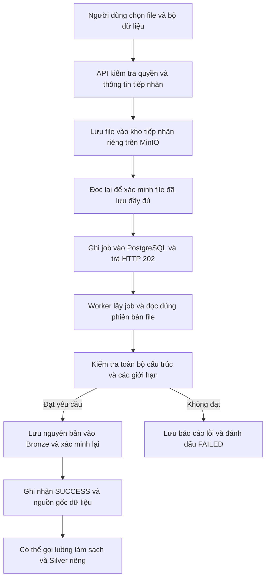

# Tải file từ máy người dùng vào Bronze

Ngày cập nhật: 09/11/2026.

## 1. Mục đích và phạm vi

`POST /api/v1/ingestion/uploads` nhận nội dung file trực tiếp từ máy người dùng. Người dùng chọn một bộ dữ liệu Bronze đã có trong danh mục; không cần đăng ký đường dẫn server, tài khoản MinIO hoặc nguồn file trước đó. Backend tự tìm hoặc tạo nguồn tải lên phù hợp với bộ dữ liệu và loại file.

Hỗ trợ CSV, Excel `.xlsx` và `.xlsm`. File phải có dòng tiêu đề. Bản đầu tiên yêu cầu tên file không dấu, chỉ gồm chữ, số, dấu gạch ngang, gạch dưới và dấu chấm, tối đa 200 ký tự; không nhận đường dẫn con. Không hỗ trợ `.xls`, PDF, Word hoặc file nén tùy ý.

`ADMIN` và `DATA_ADMIN` được tải file vào mọi bộ dữ liệu Bronze được phép. Nhân viên phòng ban cũng có thể tải file, nhưng chỉ vào đúng miền dữ liệu đã đăng ký: `HR_STAFF` → `hr`, `ACADEMIC_STAFF` → `academic`, `ADMISSIONS_STAFF` → `admissions`. Miền được lấy từ `dataset_id` trong danh mục, không nhận từ form tải lên; gửi file sang miền khác trả `403`. Bộ dữ liệu phải đang hoạt động, thuộc tầng Bronze và có hệ thống nguồn đang hoạt động. Việc tạo bộ dữ liệu mới không nằm trong endpoint này.

## 2. Luồng xử lý



Kho tiếp nhận mặc định là `ingestion-uploads`, tách biệt với Bronze, Silver và Gold. File nằm trong kho này chưa được công nhận là dữ liệu Bronze. Chỉ kết quả job `SUCCESS` mới xác nhận đã lưu Bronze thành công.

API tạo khóa riêng cho mỗi lần tải lên: `incoming/{dataset_id}/{mã-lần-tải}/{tên-file}`. Vì vậy, hai người tải cùng tên file không ghi đè nhau. Sau khi lưu, API đọc lại đúng phiên bản để đối chiếu kích thước và mã kiểm tra nội dung. Chỉ khi file và job đều được lưu thành công mới trả HTTP 202.

Worker dùng chung hàng đợi, cơ chế giữ job, gia hạn và cập nhật kết quả với ingestion hiện có. Job tải lên có `job_type=UPLOAD_V1`; nguồn đã đăng ký vẫn dùng `EXECUTION_V1`.

## 3. So sánh hai API

| Nội dung | `/ingestion/jobs` | `/ingestion/uploads` |
|---|---|---|
| Đầu vào | JSON chỉ định nguồn và file/bảng đã có | File gửi trực tiếp, mã bộ dữ liệu và tùy chọn đọc |
| Cần đăng ký vị trí nguồn | Có | Không; backend tự tạo nguồn tải lên |
| Thu thập PostgreSQL | Có | Không |
| Tạo job và xử lý bằng worker | Có | Có |
| Kiểm tra và lưu bản gốc vào Bronze | Có | Có |
| Theo dõi bằng API job | Có | Có |
| Tự động làm sạch và chạy Silver | Chưa có | Chưa có |

Nguồn tải lên được dùng lại theo bộ dữ liệu và loại file, với tên nội bộ `UPLOAD_{dataset_id}_{CSV hoặc EXCEL}`. Nguồn này không có đường dẫn server và không chứa thông tin kết nối. Không thể dùng `/ingestion/jobs` để yêu cầu đọc tùy ý từ nguồn tải lên; phải gửi file qua `/ingestion/uploads`.

## 4. Cách gọi API

### CSV mặc định

```sh
curl -X POST 'http://localhost:8000/api/v1/ingestion/uploads' \
  -H "Authorization: Bearer $TOKEN" \
  -F 'dataset_id=7' \
  -F 'file=@/duong-dan/employees.csv'
```

Mặc định CSV là UTF-8, phân cách bằng dấu phẩy, có dòng tiêu đề, dấu nháy kép bao giá trị và không bỏ dòng đầu. Các giá trị được giữ nguyên trong file gốc; chưa chuyển kiểu hoặc làm sạch ở bước này.

### CSV có cách đọc riêng

```sh
curl -X POST 'http://localhost:8000/api/v1/ingestion/uploads' \
  -H "Authorization: Bearer $TOKEN" \
  -F 'dataset_id=7' \
  -F 'parser_options={"delimiter":";","encoding":"utf-8","skip_rows":0}' \
  -F 'file=@/duong-dan/employees.csv'
```

### Excel

```sh
curl -X POST 'http://localhost:8000/api/v1/ingestion/uploads' \
  -H "Authorization: Bearer $TOKEN" \
  -F 'dataset_id=7' \
  -F 'parser_options={"sheet_name":"NhanSu","header_row":1,"skip_rows":0}' \
  -F 'file=@/duong-dan/employees.xlsx'
```

Không truyền `sheet_name` thì worker chọn sheet đầu tiên và ghi lại tên thực tế vào kết quả. Một lần tải lên chỉ xử lý một sheet. File Excel nguyên bản vẫn được giữ đầy đủ trong Bronze, gồm cả các sheet khác.

Trên Swagger, chọn `POST /api/v1/ingestion/uploads`, bấm **Try it out**, chọn file, điền `dataset_id`, tùy chọn `parser_options`, rồi thực thi. Không tự đặt HTTP `Content-Type` khi dùng công cụ gửi form; để công cụ tạo thông tin phân tách multipart.

API trả HTTP 202 với `ingestion_job_id`, `job_type=UPLOAD_V1`, `status=QUEUED`, `data_source_id`, `dataset_id` và tên file trong `source_table`. HTTP 202 nghĩa là đã tiếp nhận để xử lý, chưa có nghĩa file đã vào Bronze.

`ADMIN`, `DATA_ADMIN` và `VIEWER` xem được các job theo quyền đọc hiện có. STAFF chỉ xem được các job thuộc miền của phòng ban mình, kể cả khi đoán được mã job của phòng ban khác.

Theo dõi bằng:

```text
GET /api/v1/ingestion/jobs/{ingestion_job_id}
GET /api/v1/ingestion/jobs?data_source_id={data_source_id}
```

Khi thành công, `output` chứa URI Bronze, phiên bản tệp, mã SHA-256, kích thước, cách đọc thực tế và nguồn gốc từ lần tải lên. `validation_report` cho biết kết quả kiểm tra. API không trả thông tin xác thực kho tiếp nhận.

## 5. Kiểm tra trước khi vào Bronze

API kiểm tra loại file, tên file, cách đọc và dung lượng thực tế trong lúc sao chép từng phần. File rỗng bị từ chối. MIME do máy người dùng gửi không được dùng làm bằng chứng file hợp lệ.

Worker đọc đúng phiên bản đã ghim, kiểm tra lại kích thước và SHA-256, sau đó quét toàn bộ phần dữ liệu được chọn:

- Dòng tiêu đề phải tồn tại, không có tên cột rỗng hoặc trùng.
- Các dòng phải có cấu trúc phù hợp với dòng tiêu đề.
- File không chỉ có tiêu đề mà không có dữ liệu.
- CSV phải đọc được theo bảng mã và dấu phân cách đã chọn.
- Excel phải có sheet được yêu cầu; ô công thức, ô lỗi và dữ liệu không có tiêu đề bị chặn.
- Giới hạn dung lượng, số dòng, số cột, độ dài ô, thời gian xử lý và kích thước giải nén Excel được áp dụng.

File mới chưa có cấu trúc đích khai báo: worker kiểm tra cấu trúc thực tế của file, không tự kết luận cột nào là mã nhân sự hay cột nào mang ý nghĩa nghiệp vụ. Bước này không sửa dữ liệu thiếu, xóa trùng, đổi tên cột hoặc tính chỉ số. Những việc đó thuộc làm sạch, chuẩn hóa và Gold ở các bước tiếp theo.

Giới hạn mặc định:

| Biến môi trường | Mặc định |
|---|---:|
| `UPLOAD_MAX_BYTES` | 50 MiB |
| `UPLOAD_MAX_RECORDS` | 1.000.000 dòng |
| `UPLOAD_MAX_COLUMNS` | 500 cột |
| `UPLOAD_MAX_CELL_CHARS` | 1.000.000 ký tự/ô |
| `UPLOAD_TIMEOUT_SECONDS` | 60 giây cho từng giai đoạn được kiểm soát |
| `UPLOAD_MAX_EXPANDED_BYTES` | 200 MiB cho tổng nội dung giải nén Excel |

Nên đặt giới hạn request tại reverse proxy tương ứng, có chừa phần thông tin multipart. Giới hạn file trong ứng dụng được kiểm tra khi đọc `UploadFile`; framework có thể đã ghi request vào file tạm trước khi endpoint chạy.

## 6. Cài đặt trên môi trường đang chạy

### PostgreSQL

Áp dụng migration sau bằng quy trình triển khai database hiện có, trước khi chạy API/worker mới:

```text
infra/postgres/migrations/20261109_ingestion_uploads.sql
```

Migration thêm cột `upload_input` và chỉ mục hàng đợi cho loại job mới; không xóa hoặc sửa kết quả job cũ. Database khởi tạo mới đã có phần này trong `infra/postgres/init/02-schema.sql`.

### MinIO và tài khoản dịch vụ

Kho `MINIO_BUCKET_UPLOADS` phải riêng biệt và bật quản lý phiên bản. Compose đã bổ sung khởi tạo kho này; với hệ thống đã chạy, thực hiện bước quản trị dưới đây bằng tài khoản quản trị trên máy triển khai:

```sh
.venv/bin/python -m app.infra.minio.upload_accounts plan
.venv/bin/python -m app.infra.minio.upload_accounts prepare
.venv/bin/python -m app.infra.minio.upload_accounts apply
.venv/bin/python -m app.infra.minio.upload_accounts export-runtime
```

`prepare` tạo `.env.upload-accounts.local` với quyền đọc/ghi giới hạn cho chủ file; không ghi đè file đang có. `apply` tạo kho, bật phiên bản và tạo hai tài khoản mới, không phải lệnh dùng để xoay thông tin xác thực của tài khoản đã tồn tại.

`export-runtime` tách thành:

- `.env.upload-backend.local`: tài khoản ghi/đọc lại trong kho tiếp nhận, không có quyền ghi Bronze.
- `.env.upload-worker.local`: tài khoản chỉ đọc kho tiếp nhận. Worker tiếp tục dùng tài khoản ghi/xác minh Bronze hiện có.

Compose nạp đúng file cho từng dịch vụ. Nếu chạy Python trực tiếp, xuất các biến trong file tương ứng vào môi trường của tiến trình trước khi khởi động; ứng dụng không tự nạp cả hai bộ tài khoản tải lên. Không đưa các file chứa thông tin xác thực vào kho mã nguồn.

Cần khởi động lại API và worker sau khi cấu hình, không chỉ cập nhật API. Thiếu tài khoản riêng hoặc kho chưa bật phiên bản thì việc tiếp nhận bị chặn; không dùng tài khoản quản trị để chạy thay.

## 7. Lỗi và phục hồi

| Tình huống | Kết quả |
|---|---|
| Không đủ quyền | HTTP 401/403; không tạo job |
| Thiếu file hoặc bộ dữ liệu | HTTP 422 |
| Bộ dữ liệu không tồn tại | HTTP 404 |
| Bộ dữ liệu không phải Bronze, bị tắt hoặc thiếu hệ thống nguồn | HTTP 422 |
| Loại file không hỗ trợ | HTTP 415 |
| Tên file, cách đọc hoặc file rỗng không hợp lệ | HTTP 422 |
| File vượt giới hạn tiếp nhận | HTTP 413; không tạo job |
| Lỗi lưu MinIO hoặc ghi job | HTTP 503; không báo đã tiếp nhận thành công |
| Nội dung file không đạt kiểm tra | Job `FAILED`, có báo cáo lỗi; không ghi Bronze |
| Worker hết thời hạn giữ job | Job `FAILED` với `WORKER_LEASE_EXPIRED`, không công bố kết quả muộn |

MinIO và PostgreSQL không có một lần lưu chung. Nếu file đã nằm trong kho tiếp nhận nhưng ghi job thất bại hoặc request bị hủy, có thể còn file không gắn với job. File đó không được worker tự nhận và không được xem là Bronze. Chưa có tác vụ tự động dọn các file này; không đặt thời hạn xóa ngắn có thể làm mất file của job còn chờ.

Các job đã thất bại không được tự động thử lại. Người dùng có thể tải lại file để tạo job mới. Các lần tải cùng tên có vị trí và phiên bản riêng. Chưa có khóa chống gửi trùng cho endpoint này.

## 8. Đi tiếp sang Silver

Sau khi job tải lên đạt `SUCCESS`, API làm sạch hiện có có thể nhận `UPLOAD_V1` và dùng đúng bản Bronze vừa lưu:

```text
POST /api/v1/pipeline/cleaning/ingestion-jobs/{ingestion_job_id}
```

Bước Silver vẫn cần cấu hình tương ứng với `data_source_id`, `dataset_id`, tên file và cấu trúc dữ liệu của nguồn. Upload không tự tạo cấu hình Silver hoặc tự chạy Gold. Xem [luồng nguồn thật → Silver](standardization/source-silver-flow.md).

## 9. Các tệp triển khai và kiểm thử

- `app/modules/ingestion/router.py`: nhận multipart và trả lỗi API có kiểm soát.
- `app/modules/ingestion/uploads.py`: kiểm tra tiếp nhận, tự tạo nguồn, lưu kho tiếp nhận và tạo job.
- `app/modules/ingestion/upload_capture.py`: xác minh đúng file và kiểm tra toàn bộ dữ liệu trong worker.
- `app/repositories/upload_repo.py`: tìm bộ dữ liệu và tự tạo hoặc dùng lại nguồn tải lên.
- `app/modules/ingestion/execution.py`, `app/ingestion_worker.py`, `app/repositories/ingestion_repo.py`: dùng chung hàng đợi, gia hạn và lưu Bronze.
- `app/infra/minio/upload_accounts.py`: chuẩn bị tài khoản riêng theo dịch vụ.

```sh
.venv/bin/python -m pytest -q tests/test_ingestion_uploads.py tests/test_upload_accounts.py tests/test_ingestion_execution.py tests/test_source_cleaning.py
```

Kiểm thử dùng CSV/Excel thật và mô phỏng MinIO trong bộ nhớ; có kiểm tra nguyên bản file, lỗi cấu trúc, sai phiên bản, SHA-256, quyền truy cập, dung lượng, lỗi kho lưu trữ và lỗi ghi job. Phần tự tạo/tái sử dụng nguồn được kiểm tra bằng SQL thật trên SQLite. Kiểm thử này không chứng minh PostgreSQL/MinIO đang vận hành đã được cấu hình hoặc migration thành công.
