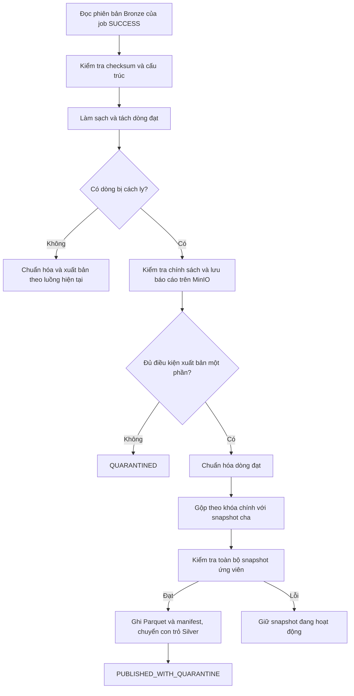

# Luồng cách ly dòng lỗi và xuất bản một phần lên Silver

API thủ công `POST /api/v1/pipeline/cleaning/ingestion-jobs/{ingestion_job_id}` thử nghiệm xuất bản một phần cho danh mục `hr/position` thuộc catalog `DEMO_FLOW_hr`. API yêu cầu quyền `ADMIN` hoặc `DATA_ADMIN` và chạy ở chế độ `rehearsal`.

| Đầu vào hoặc kết quả kiểm tra | Quyết định |
| --- | --- |
| Job Bronze chưa thành công, sai phiên bản/checksum, cấu trúc nguồn sai hoặc cấu hình không hợp lệ | Dừng lượt và trả lỗi API |
| Cleaning phát hiện dòng thiếu dữ liệu, sai định dạng hoặc xung đột khóa | Ghi báo cáo cách ly. Cả nhóm trùng khóa xung đột bị loại khỏi tập dòng đạt |
| `hr/position` còn dòng đạt, số dòng cách ly không quá **10 dòng** và **10% số dòng đọc** | Thử chuẩn hóa và xuất bản các dòng đạt |
| Vượt giới hạn, toàn bộ dòng bị cách ly hoặc dataset khác có dòng bị cách ly | Trả `QUARANTINED`, không tạo snapshot mới |
| Mapping, chuyển kiểu, crosswalk hoặc kiểm tra snapshot ứng viên thất bại | Dừng xuất bản và giữ snapshot đang hoạt động |

Ngưỡng trên là chính sách thử nghiệm `hr-position-partial-v1` do backend đặt. API không nhận tùy chọn bỏ qua điều kiện này từ client.

Ví dụ một batch đọc 100 dòng và cách ly 2 dòng. Nếu 98 dòng còn lại chuẩn hóa thành công, Silver thêm hoặc cập nhật chúng theo `position_id` chuẩn. Các khóa không có trong 98 dòng được giữ từ snapshot cha, kể cả dữ liệu đã công bố của dòng bị cách ly. Cơ chế này áp dụng cho lượt xuất bản một phần. Lượt đầy đủ vẫn thay thế entity theo hành vi hiện tại.

Báo cáo JSON nằm trong bucket Silver dưới `silver/rehearsal/quarantine/job-<id>/`. Báo cáo chứa job ID, phiên bản và checksum Bronze, quyết định chính sách, số dòng, mã lỗi, phiên bản quy tắc và vị trí dòng. Giá trị gốc tra cứu từ Bronze theo vị trí dòng. API trả tham chiếu tại `quarantine_report`; manifest Silver giữ tham chiếu này nếu xuất bản thành công. `publication.records_published` đếm số dòng từ batch hiện tại được xuất bản, không bao gồm các dòng giữ lại từ snapshot cha.

Nếu ghi hoặc xác minh báo cáo thất bại, API dừng lượt. Nếu báo cáo đã lưu nhưng chuẩn hóa hoặc xuất bản thất bại sau đó, có thể tra báo cáo theo tiền tố của job. Trạng thái `ALLOW_PARTIAL` trong báo cáo là quyết định cho phép thử xuất bản, không phải kết quả xuất bản. Cùng input, báo cáo và snapshot cha có thể tái sử dụng snapshot đã công bố. Với `base_snapshot="active"`, hệ thống tra snapshot đang hoạt động tại thời điểm gọi.

Data Admin dùng báo cáo để phân loại và phối hợp với phòng Nhân sự. Dữ liệu nguồn sai thì sửa nguồn và tạo job Bronze mới. Cấu hình chuẩn hóa sai thì sửa cấu hình và chạy lại từ phiên bản Bronze đã lưu. Báo cáo này hỗ trợ truy vết và chưa thay thế quy trình giao việc xử lý lỗi.

Các điểm vào code: `manual_cleaning.py` quyết định chính sách và lưu báo cáo. `silver_pipeline.py` chuẩn hóa đúng tập dòng đã làm sạch. `silver_publication.py` gộp theo khóa, giữ nguồn gốc dòng cũ và kiểm tra snapshot trước khi kích hoạt.

Kiểm thử tự động xác nhận ca đúng ngưỡng, vượt ngưỡng, dataset dùng chính sách chặn cả batch, giữ bản ghi và nguồn gốc từ snapshot cha, tái sử dụng kết quả khi chạy lại cùng snapshot cha, và giữ con trỏ khi báo cáo không đọc được hoặc chuẩn hóa lỗi. Bộ test backend có 1.023 ca đạt, 9 ca tích hợp live bị bỏ qua theo cấu hình, độ bao phủ 87,89%. Ca xuất bản một phần dùng kho đối tượng local và metadata SQLite trong kiểm thử. Chưa chạy ca này qua PostgreSQL và MinIO thật.
