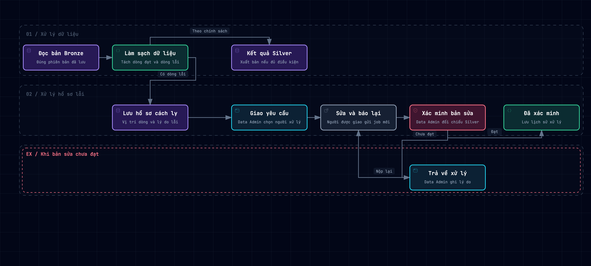

# Báo cáo cho team — Quản lý và khắc phục lỗi dữ liệu

**Cập nhật ngày 06/11/2026.** UniLake đã có luồng để Data Admin tìm dòng lỗi, giao cho người phụ trách, nhận bản sửa và xác minh kết quả. Các chức năng đã được triển khai ở backend và chạy thử trên môi trường dev bằng dữ liệu mẫu.

## Team có thể làm gì?

| Phần | Chức năng đã có |
| --- | --- |
| **A. Theo dõi lượt làm sạch** | Tìm lượt theo bộ dữ liệu, job nạp, trạng thái hoặc thời gian. Xem số dòng đọc, đạt, cách ly, gộp trùng và số dòng thực sự lên Silver. Mở báo cáo cách ly nếu lượt có báo cáo. |
| **B. Tra cứu từng dòng lỗi** | Lọc hồ sơ theo lượt, job, bộ dữ liệu, mã lỗi hoặc phòng sở hữu dữ liệu. Xem lý do, trường lỗi và vị trí dòng. Data Admin có quyền có thể mở dòng từ đúng bản Bronze đã lưu của bộ dữ liệu demo. Thống kê đếm một dòng là một hồ sơ, dù dòng đó có nhiều lỗi. |
| **C. Giao việc và xác minh** | Data Admin gom một hoặc nhiều dòng lỗi của cùng bộ dữ liệu vào một yêu cầu, giao cho phòng ban và chọn người phụ trách. Người phụ trách gửi bản sửa để Data Admin xác minh. Lịch sử lưu người thao tác, thời gian, việc bàn giao và lý do trả lại. |

**Làm sạch xong và lên Silver là hai kết quả riêng.** Ví dụ, một lượt đọc 100 dòng, 98 dòng đạt và 2 dòng bị cách ly. Nếu bộ dữ liệu áp dụng chính sách chặn cả lượt, số dòng lên Silver là 0 nhưng hai hồ sơ lỗi vẫn tra được. Riêng danh mục chức vụ demo cho phép đưa dòng đạt lên Silver khi số dòng cách ly không quá **10 dòng và 10% số dòng đọc**, đồng thời các bước kiểm tra tiếp theo đều đạt. Lượt sạch không có dòng cách ly sẽ không có báo cáo cách ly.

## Sơ đồ luồng hoạt động

[Mở sơ đồ tương tác](diagrams/quarantine-workflow.html) · [Tải ảnh PNG](diagrams/quarantine-workflow.png)

Hệ thống xét điều kiện xuất bản Silver và lưu hồ sơ cho các dòng lỗi. Khi có hồ sơ cách ly, Data Admin có thể giao xử lý dù lượt đó đã xuất bản một phần hay bị chặn. Nếu bản sửa chưa đạt, người được giao tiếp tục xử lý và nộp lại.

## Quy trình xử lý một yêu cầu

1. **Data Admin tìm lỗi và giao việc.** Mở lượt làm sạch hoặc danh sách hồ sơ, chọn các dòng liên quan rồi giao cho đúng phòng. Nếu chưa chọn người, yêu cầu vẫn ở trạng thái **Cần xử lý** và phải được giao cho một người trước khi có thể báo đã sửa.
2. **Người phụ trách sửa tại nguồn và báo lại.** Sau khi bản sửa được nạp vào Bronze thành công, người phụ trách gửi mã job mới và ghi chú. Yêu cầu chuyển sang **Chờ xác minh**. Người cùng phòng có quyền vẫn xem được yêu cầu, nhưng chỉ người phụ trách hiện tại và còn quyền mới được gửi kết quả. Data Admin cũng không thể báo thay.
3. **Data Admin đối chiếu và xác minh.** Nếu lượt mới đã xuất bản Silver và từng hồ sơ liên quan đã được đối chiếu đúng, yêu cầu chuyển sang **Đã xác minh**. Nếu vẫn lỗi, Data Admin trả về **Cần xử lý** và ghi lý do. Khi thứ tự dòng thay đổi giữa hai file, dùng khóa nghiệp vụ, chẳng hạn mã học kỳ, để đối chiếu đúng bản ghi.

Data Admin có thể đổi người phụ trách trong phòng đã giao khi yêu cầu còn **Cần xử lý**. Sau khi bàn giao, quyền báo đã sửa thuộc về người mới.

## Kết quả kiểm tra

- **Job #5** nạp file Excel mẫu có ngày sai. Cleaning chặn xuất bản, nhưng Data Admin vẫn tra được hồ sơ và mở đúng dòng 2 của sheet `Data` từ bản Bronze đã lưu.
- **Job #6** xuất bản Silver thành công với dữ liệu mẫu hợp lệ. Lượt này có 0 dòng cách ly nên không có báo cáo cách ly.
- **Job #9 và #10** minh họa vòng sửa và xác minh. Bản nộp đầu vẫn lỗi và bị trả về. Bản sau lên Silver, được Data Admin đối chiếu và xác minh. Ca thử quyền cũng xác nhận người cùng phòng, người đã bàn giao và Data Admin đều bị chặn khi báo thay.
- Bộ kiểm thử backend đạt **1.033 ca**. Chín ca tích hợp được bỏ qua theo cấu hình. Các luồng chính ở trên đã được chạy thử riêng qua API, PostgreSQL và MinIO trên Docker dev.

## Phạm vi hiện tại

- Đã có **13 API backend** trong Nhóm A–C, gồm 3 API lượt làm sạch, 4 API hồ sơ cách ly và 6 API yêu cầu xử lý. Màn hình thao tác và thông báo tự động chưa thuộc phần đã triển khai.
- Việc đối chiếu từng bản ghi sau khi sửa do Data Admin thực hiện. Xem dòng Bronze qua API hiện giới hạn ở bộ dữ liệu demo được phép và file tối đa 8 MiB.
- Chuyển yêu cầu sang phòng khác và xuất CSV/Excel hàng loạt được hoãn. Lịch sử và hồ sơ từ trước khi triển khai chưa được nhập lại.

Tài liệu cho người tích hợp: [Lượt làm sạch](cleaning-run-management.md), [Hồ sơ cách ly](quarantine-records.md) và [Yêu cầu xử lý lỗi](data-quality-issues.md).
