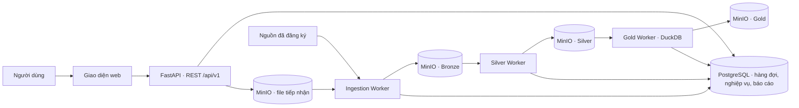

# Tài liệu kiến trúc hệ thống UniLake AI

Tài liệu mô tả backend UniLake AI theo mã nguồn và chuỗi migration trong repository `Unilake-BE`. Hệ thống tiếp nhận dữ liệu Tuyển sinh, Đào tạo và Nhân sự, giữ nguồn gốc qua ba tầng Bronze, Silver và Gold, rồi cung cấp số liệu báo cáo theo quyền truy cập. Giao diện web được mô tả ở ranh giới tích hợp với API.

## 1. Thiết kế hệ thống

### 1.1 Thành phần và luồng dữ liệu

FastAPI tổ chức API theo module nghiệp vụ. Ba worker chạy trong tiến trình riêng để việc đọc file, làm sạch và tổng hợp có thể tiếp tục sau khi API trả kết quả tiếp nhận. PostgreSQL giữ hàng đợi của pipeline. Docker Compose khai báo thêm Redis, còn việc lựa chọn và theo dõi job của ba worker dựa trên PostgreSQL.



| Thành phần | Trách nhiệm | Mã nguồn hoặc cấu hình |
| --- | --- | --- |
| API và xác thực | Đăng nhập, kiểm tra phiên và quyền, định tuyến, gắn mã yêu cầu `X-Request-ID` | [app/main.py](app/main.py), [app/core/deps.py](app/core/deps.py) |
| Nguồn và tiếp nhận | Quản lý nguồn/dataset, nhận file hoặc tạo job đọc nguồn, kiểm tra đầu vào và ghi Bronze | [app/modules/datasources](app/modules/datasources), [app/modules/ingestion](app/modules/ingestion) |
| Xử lý dữ liệu | Điều phối Silver và Gold, lưu phiên bản, cách ly bản ghi lỗi, đồng bộ nghiệp vụ | [app/modules/pipeline](app/modules/pipeline), [docker-compose.yml](docker-compose.yml) |
| Quản trị dữ liệu | Danh mục, nguồn gốc, cấu hình làm sạch, báo cáo lỗi và theo dõi xử lý | [app/modules/governance](app/modules/governance), [app/modules/pipeline/routers](app/modules/pipeline/routers) |
| Nghiệp vụ và báo cáo | Quản lý đăng ký tuyển sinh, kết quả và nhập học. Cung cấp API tổng quan và phân tích cho Manager và Viewer | [app/modules/admissions](app/modules/admissions), [app/modules/manager](app/modules/manager), [app/modules/viewer](app/modules/viewer) |

### 1.2 Tích hợp API và phân quyền

API dùng tiền tố `/api/v1` và xác thực bằng JWT Bearer. Swagger tại `/docs` mô tả hợp đồng của ứng dụng đang chạy. Nạp file thành công ở bước tiếp nhận trả HTTP `202` và mã job. Ứng dụng theo dõi trạng thái xử lý qua API ingestion, Silver và Gold.

| Vai trò | Phạm vi chính |
| --- | --- |
| `ADMIN` | Quản lý tài khoản, vai trò, phân công, cấp quyền Domain Owner và xem nhật ký IAM. Cần thêm `DATA_ADMIN` để vận hành dữ liệu. |
| `DATA_ADMIN` | Quản lý nguồn, dataset và pipeline theo quyền của từng API. |
| `*_STAFF` | Nộp dữ liệu và theo dõi lần nạp hoặc yêu cầu xử lý lỗi trong phạm vi được cấp. |
| `*_MANAGER` | Đọc báo cáo và tình trạng chất lượng trong lĩnh vực và phòng sở hữu dataset tương ứng. Một số nghiệp vụ, như đính chính tuyển sinh, có điều kiện riêng. |
| `VIEWER` | Đọc tổng hợp, metadata dataset đang hoạt động và tình trạng chất lượng của ba lĩnh vực qua API Viewer. |

Các phòng dùng để phân quyền theo lĩnh vực gồm `PTS` (Tuyển sinh), `PDT` (Đào tạo) và `PNS` (Nhân sự). Tham số lọc do client gửi được áp dụng trong phạm vi backend đã xác định. Quyền truy cập MinIO được cấu hình theo tác vụ, ví dụ worker Gold đọc vùng Silver đã công bố và ghi vùng Gold.

Mã nguồn hiện tại đăng ký `POST /api/v1/nlq/ask`, nhưng provider được gắn trong FastAPI trả HTTP `503` với mã `NLQ_UNAVAILABLE`. Báo cáo Manager và Viewer được phục vụ qua API báo cáo hiện hành. [Provider NLQ](app/providers.py), [API IAM](docs/api/admin-iam.md), [API Manager](docs/api/manager-api.md), [API Viewer](docs/api/viewer-api.md)

### 1.3 Trạng thái người dùng cần theo dõi

| Mốc | Ý nghĩa |
| --- | --- |
| Upload trả `202` | File đã được tiếp nhận và lần nạp đã được xếp hàng. |
| Ingestion `SUCCESS` | Bronze đã được kiểm chứng, kết quả lần nạp và thông tin truy vết đã được ghi. |
| Silver `PUBLISHED` hoặc `PUBLISHED_WITH_QUARANTINE` | Phiên bản dữ liệu sạch đã được công bố. Trạng thái thứ hai áp dụng khi chính sách cho phép công bố một phần và có bản ghi bị cách ly. |
| Gold `SUCCEEDED` | Số liệu tổng hợp của phiên bản đã được công bố. |
| Đồng bộ `SYNCED` | Giao dịch ghi các bảng nghiệp vụ đã hoàn tất. Job đồng bộ có thể `BLOCKED` hoặc `FAILED` sau khi Gold đã công bố. |

## 2. Thiết kế cơ sở dữ liệu

### 2.1 Phân bổ lưu trữ

| Nơi lưu | Dữ liệu và vai trò |
| --- | --- |
| MinIO, vùng tiếp nhận | File người dùng tải lên. Job ghim tham chiếu phiên bản và SHA-256 để đọc lại khi xử lý hoặc thử lại. |
| MinIO, Bronze | Bản sao file gốc hoặc Parquet xuất từ nguồn PostgreSQL. Tham chiếu object, phiên bản và kết quả kiểm chứng được liên kết với job. |
| MinIO, Silver | Dữ liệu chuẩn hóa dạng Parquet, bản kê phiên bản (manifest), hồ sơ cách ly dạng artifact và metadata quản lý phiên bản, cấu hình, phê duyệt. |
| MinIO, Gold | Parquet tổng hợp và manifest. Khi có luồng đồng bộ, worker tạo thêm artifact dữ liệu chi tiết đã kiểm chứng. |
| PostgreSQL, schema `app` | Tài khoản, danh mục, bảng nghiệp vụ, hàng đợi, kết quả làm sạch, hồ sơ chất lượng, lineage và phiên bản Silver đã chốt làm đầu vào Gold. |
| PostgreSQL, schema `gold` | Số liệu tổng hợp có phiên bản trong `gold.aggregate`, phục vụ đọc hiện hành qua `gold.current_metrics` và các view theo lĩnh vực. |

Migration mô hình lưu trữ V2 chuyển metadata Silver sang MinIO. Với cơ sở dữ liệu cũ có dữ liệu trong các bảng Silver, migration kiểm tra bằng chứng xuất dữ liệu theo số dòng và fingerprint trước khi bỏ bảng. Quy trình nâng cấp chung nằm ở [upgrade.psql](infra/postgres/migrations/upgrade.psql) và [migration mô hình lưu trữ V2](infra/postgres/migrations/20261116_storage_model_v2.sql).

### 2.2 Mô hình quan hệ nghiệp vụ

Các bảng dưới đây thuộc schema `app`. Sơ đồ thể hiện các quan hệ chính giữa ba lĩnh vực.

```mermaid
erDiagram
    DEPARTMENT ||--o{ MAJOR : quan_ly
    MAJOR ||--o{ PROGRAM : co
    APPLICANT ||--o{ ADMISSION : dang_ky
    PROGRAM ||--o{ ADMISSION : tiep_nhan
    ADMISSION_YEAR ||--o{ ADMISSION : thuoc_dot
    ADMISSION_METHOD ||--o{ ADMISSION : ap_dung
    ADMISSION o|--o| STUDENT : tham_chieu
    PROGRAM ||--o{ CURRICULUM : co
    CURRICULUM ||--o{ CURRICULUM_COURSE : gom
    COURSE ||--o{ CURRICULUM_COURSE : duoc_dua_vao
    COURSE ||--o{ CLASS : mo_lop
    SEMESTER ||--o{ CLASS : to_chuc
    STUDENT ||--o{ ENROLLMENT : dang_ky
    CLASS ||--o{ ENROLLMENT : tiep_nhan
    ENROLLMENT ||--o| ENROLLMENT_GRADE : co_diem
    EMPLOYEE ||--o{ ASSIGNMENT : duoc_phan_cong
    DEPARTMENT ||--o{ ASSIGNMENT : tiep_nhan
    POSITION ||--o{ ASSIGNMENT : quy_dinh
    EMPLOYEE ||--o| LECTURER : co_ho_so
    LECTURER ||--o{ CLASS_LECTURER : giang_day
    CLASS ||--o{ CLASS_LECTURER : phan_cong
```

- **Tuyển sinh.** Khóa duy nhất của `admission` gồm thí sinh, chương trình, đợt và phương thức. Một hồ sơ có thể được tham chiếu bởi tối đa một `student`. Quy trình xác nhận nhập học cập nhật hồ sơ tuyển sinh. Việc tạo sinh viên nằm ngoài thao tác xác nhận này.
- **Đào tạo.** `curriculum` duy nhất theo chương trình và phiên bản. `curriculum_course` liên kết khung chương trình với học phần. `enrollment` duy nhất theo sinh viên và lớp, mỗi lượt có tối đa một bản ghi `enrollment_grade`.
- **Nhân sự.** `assignment` liên kết nhân viên, phòng ban và chức vụ, có thời gian hiệu lực. `lecturer.employee_id` đồng thời là khóa chính và khóa ngoại. Bảng `class_lecturer` liên kết giảng viên với lớp, còn `employee_qualification` liên kết nhân viên với văn bằng hoặc chứng chỉ.

Nguồn DDL và thay đổi nghiệp vụ nằm tại [02-schema.sql](infra/postgres/init/02-schema.sql) và [migration tuyển sinh](infra/postgres/migrations/20261118_update_admissions_workflows.sql).

### 2.3 Bảng quản lý và ràng buộc

| Nhóm | Bảng hoặc view chính | Thiết kế |
| --- | --- | --- |
| Danh tính và quyền | `app_user`, `role`, `permission`, `user_role`, `role_permission`, `login_session`, `iam_event` | Bảng liên kết hỗ trợ nhiều vai trò cho một tài khoản. Phiên và sự kiện phục vụ kiểm tra truy cập và truy vết thay đổi quyền. |
| Danh mục | `source_system`, `data_source`, `dataset`, `data_layer`, `catalog_metadata` | Dataset tham chiếu tầng và có thể gắn đơn vị sở hữu. Cấu hình nguồn và metadata mở rộng dùng JSONB. |
| Điều phối | `ingestion_job`, `auto_pipeline_job`, `auto_pipeline_attempt`, `gold_scope`, `gold_job`, `gold_attempt`, `gold_sync_job` | PostgreSQL lưu job, trạng thái và lịch sử xử lý. Gold duy nhất theo cặp `(scope, generation)`. Mỗi Gold job có tối đa một job đồng bộ. |
| Chất lượng và lineage | `cleaning_run`, `quarantine_record`, `data_quality_issue`, `data_quality_issue_record`, `data_quality_issue_event`, `pipeline_lineage` | Hồ sơ cách ly gắn kết quả làm sạch, yêu cầu xử lý liên kết các bản ghi lỗi và lưu lịch sử. Lineage liên kết nguồn, job và artifact giữa các tầng. |
| Định danh và đồng bộ nghiệp vụ | `canonical_identity`, `identity_crosswalk`, `crosswalk_release`, `gold_record_identity`, `business_import_change`, `admission_event`, `admission_correction` | Crosswalk lưu đối chiếu định danh đã có. Đồng bộ Gold theo dõi liên kết giữa khóa nguồn và khóa đích cùng lịch sử thay đổi nghiệp vụ. |
| Báo cáo Gold | `gold.aggregate`, `gold.current_metrics` | Khóa số liệu gồm `(job_id, entity, metric, dimensions)` và giá trị đếm phải không âm. View chỉ lấy job thành công khớp thế hệ và snapshot Silver hiện hành. |

Khóa chính và khóa ngoại duy trì liên kết giữa các bảng. Chỉ mục hàng đợi hỗ trợ tìm job theo trạng thái và thời điểm xử lý. Chỉ mục duy nhất có điều kiện trên ingestion ngăn hai job đọc nguồn cùng loại ở trạng thái chờ hoặc đang chạy cho một nguồn.

## 3. Thiết kế giải thuật

### 3.1 Tiếp nhận và ghi Bronze

1. API xác định quyền, nguồn, dataset và cấu hình đọc. Với upload, API lưu file vào vùng tiếp nhận rồi ghi job chứa tham chiếu file. Với nguồn đăng ký, job giữ thông tin cần thiết để worker chọn bộ đọc.
2. Worker nhận job bằng khóa hàng `FOR UPDATE SKIP LOCKED`, chuyển trạng thái sang đang chạy rồi đọc dữ liệu. Bộ đọc kiểm tra cấu trúc, kiểu file và các giới hạn theo cấu hình. Bước này tạo báo cáo tiếp nhận và giữ vị trí dòng nguồn nếu bộ đọc cung cấp.
3. Worker ghi Bronze, đọc lại đúng phiên bản object và đối chiếu SHA-256. Giao dịch kết thúc ghi trạng thái thành công và lineage. Trigger xếp Silver cho lần nạp đủ điều kiện trong cùng giao dịch.
4. Lỗi hạ tầng tạm thời có thể tạo lượt thử mới, liên kết bằng `root_job_id` và số lượt chạy. Khi đã có checkpoint Bronze, lượt thử đối chiếu lại file đầu vào và object ghi trước đó để có thể dùng lại. Lỗi cấu trúc file, checksum hoặc cấu hình cần xử lý nguyên nhân trước.

Chi tiết ở [dịch vụ ingestion](docs/ingestion-execution.md) và [cơ chế thử lại](docs/ingestion-reliability.md).

### 3.2 Chuẩn hóa và công bố Silver

1. Worker đọc Bronze đã ghim và chọn profile theo cấu hình khớp nguồn/file hoặc quy tắc mặc định `auto-source-v1`. Quy tắc mặc định chỉ gán hợp đồng nghiệp vụ khi cấu trúc khớp duy nhất. File còn lại được chuẩn hóa theo các cột thực tế.
2. Pipeline ánh xạ cột, chuyển kiểu theo hợp đồng, chuẩn hóa giá trị và kiểm tra cấu trúc, khóa, tham chiếu. Mã định danh như `007` được giữ dạng chuỗi. Trường ngày mơ hồ bị xử lý theo quy tắc đã khai báo. Những cột thông tin cá nhân được hợp đồng loại khỏi tập phân tích có thể thuộc artifact nghiệp vụ riêng nếu cần cho bước đồng bộ.
3. Hệ thống ghi hồ sơ cách ly kèm mã lỗi và vị trí dòng, nếu xác định được. Với luồng tự động mặc định, file lỗi giữ nguyên bản tốt hiện hành. Luồng được phép công bố một phần còn phải kiểm tra khóa nguồn và điều kiện chính sách trước khi nhận phần dữ liệu sạch.
4. Worker ghi Parquet và manifest có checksum, đọc lại để kiểm chứng rồi khóa phạm vi công bố. Nó đối chiếu snapshot nền và kiểm tra lại lease hoặc phê duyệt tương ứng. Phạm vi tự động được xác định theo dataset, nguồn và file để các file trong cùng dataset có thể giữ phiên bản riêng.
5. Metadata MinIO ghi trạng thái chuẩn bị trước khi chốt PostgreSQL. Khi giao dịch ghi kết quả và xếp Gold đã commit, nếu cập nhật metadata cuối gặp lỗi thì bản ghi Gold đã chốt giúp xác minh snapshot Silver đã công bố.

Chi tiết ở [luồng Silver tự động](docs/auto-silver-pipeline.md), [dịch vụ công bố](app/modules/pipeline/silver/publication.py) và [repository Silver](app/modules/pipeline/repositories/silver.py).

### 3.3 Tổng hợp và công bố Gold

1. Gold Worker nhận job đã ghim phiên bản Silver, phạm vi dữ liệu và fingerprint của công thức. Worker kiểm tra manifest, checksum, số dòng và nguồn gốc trước khi tổng hợp.
2. DuckDB tính `record_count` và đếm theo từng chiều đã cấu hình, ví dụ trạng thái nhân viên hoặc phương thức tuyển sinh. Giá trị thiếu được giữ thành nhóm riêng. `group-counts-v2` bổ sung phép đếm theo khóa phân biệt cho các mẫu nhập hỗ trợ, ví dụ số thí sinh theo mã trong phạm vi nguồn.
3. Worker ghi và kiểm chứng Parquet Gold. Giao dịch công bố xác nhận lease và thế hệ của job, sau đó ghi số liệu, lineage và con trỏ Gold hiện hành. Nếu Silver đã thay đổi trong lúc xử lý, job cũ không thể thay thế bản mới.
4. API báo cáo đọc phiên bản khớp Silver hiện hành. Khi Silver đã đổi và Gold mới chưa sẵn sàng, view hiện hành loại số liệu của phiên bản cũ. Báo cáo theo mã job vẫn có thể truy xuất lịch sử theo quyền.

`record_count` đếm bản ghi trong phạm vi nguồn. Chỉ các công thức có khóa phân biệt mới đếm thực thể theo khóa đã khai báo. [Giải thuật tổng hợp](app/modules/pipeline/services/gold_engine.py), [migration công thức Gold](infra/postgres/migrations/20261118_business_imports.sql)

### 3.4 Đồng bộ file vào nhiều bảng nghiệp vụ

Sau khi Gold thành công, trigger xếp `gold_sync_job`. Worker kiểm chứng artifact chi tiết, xác định hợp đồng nhập và đối chiếu phạm vi hiện hành. Với các hợp đồng có bước lập kế hoạch, worker gom dòng theo khóa nghiệp vụ, tra danh mục theo lô và lưu kế hoạch với các thao tác dự kiến cùng bằng chứng file nguồn. Trước khi ghi, worker kiểm tra lại quyền và lập lại kế hoạch trong giao dịch ghi. Kế hoạch đã thay đổi bị chặn với `IMPORT_PLAN_STALE`.

Khi hợp lệ, worker ghi bản ghi cha trước, dùng khóa đích cho bản ghi con, rồi ghi đối chiếu định danh, nhật ký thay đổi và trạng thái `SYNCED` trong cùng giao dịch. Ví dụ, nhập khung chương trình xử lý `curriculum` trước `curriculum_course`. File chưa có quy định ghi đích vẫn có thể tạo thống kê Gold, còn bước đồng bộ nghiệp vụ sẽ bị chặn. [Luồng nhập nhiều bảng](docs/business-imports-implementation.md), [worker đồng bộ Gold](app/modules/pipeline/services/gold_business_sync.py)

### 3.5 Cập nhật kết quả xét tuyển và nhập học

Luồng cập nhật tìm đăng ký đã tồn tại theo mã nguồn và khóa đối chiếu, kiểm tra `expected_revision`, quyền và trạng thái hiện tại. Điểm phải theo thang của phương thức tuyển sinh. Kết quả do file hoặc yêu cầu đính chính cung cấp.

| Trạng thái | Chuyển trạng thái thường dùng |
| --- | --- |
| Kết quả xét tuyển | STAFF có thể chuyển `APPLIED` sang `WAITLISTED`, `ACCEPTED` hoặc `REJECTED`, và chuyển `WAITLISTED` sang `ACCEPTED` hoặc `REJECTED`. Đổi kết quả đã chốt đi qua quy trình đính chính. |
| Nhập học | Hồ sơ `ACCEPTED` có thể chuyển từ `PENDING` sang `CONFIRMED` hoặc `DECLINED` qua file của STAFF. Rút, khôi phục và đối soát trạng thái cũ đi qua yêu cầu riêng, có lý do và kiểm tra phiên bản. |

Trạng thái và sự kiện nghiệp vụ được ghi cùng giao dịch để truy lại quyết định theo từng lần cập nhật. [Quy trình tuyển sinh](docs/admissions-workflows.md), [chính sách trạng thái](app/modules/admissions/policy.py)
